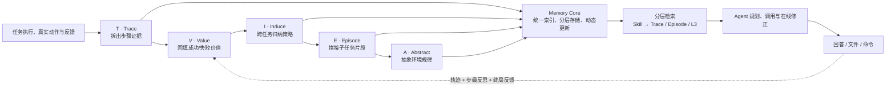

# QCon 2026｜AI Agent 主题分类梳理

> **整理范围**：仓库现有 **75 份 official PDF + 19 份 recording PDF**；本文归并为 **6 个主题、19 个详细单元**，其中 13 个单元有高置信同场 official，6 个单元保持 recording／现场照片口径，其余 62 份 official 仅作资料索引，不在本文擅自扩写。另以 Photos 中 **8 个 QCon 相簿、195 个媒体条目**（193 张现场照片、2 段演示视频）辅助核对；这些媒体**未随仓库发布**。完整映射见[资料来源映射](source-map.md)。
>
> **阅读口径**：同场 **official 幻灯片为主源**，recording（AI 摘要或录音整理纪要）只补口述、问答与转写上下文；冲突时采用 official，recording 独有内容明确标注，不与 official 页码混写。无可靠同场 official 的单元不借相似主题补证。现场照片只确认所拍画面，也不是完整演讲记录。页码均指 **PDF 物理页**；效果和性能数字均为“资料称 / 讲者称”，未做独立验证；`【待核】` 表示转写、统计或来源仍有疑点。

**核心主线**：三天分享反复讨论的不是“怎样让模型生成更多”，而是**怎样把概率性的模型能力，纳入可约束、可验证、可恢复、可治理的工程闭环**。

```text
业务目标与风险
  → Spec / 验收标准
  → Context / 知识 / Skill / Tool
  → Loop / Harness / Workflow / Sub-agent
  → 执行与 Trace
  → 评估 / 回放 / AB / Bad Case 归因
  → 版本化修改 / 发布 / 回滚

沙箱、身份权限、审计、成本与人工控制点贯穿整个流程。
```

## 分类目录

| 主题                    | 内容单元                                             |
| --------------------- | ------------------------------------------------ |
| 一、AI 研发范式、质量与团队交付     | 微软 Copilot；B 站确定性工程；AI CR；华为研发范式；CodeWave；飞猪交付大脑 |
| 二、Agent 运行平台、安全与自动化迭代 | AgentOps；沙箱；快手 AI 原生架构；字节 Agentic Supabase；自动化迭代 |
| 三、Agent 评估体系与平台       | 两份评估资料合并对照                                       |
| 四、知识、本体与记忆系统          | Cosmo DataMind；记忆张量                              |
| 五、垂直业务 Agent 案例       | Deep Swarm；Mira；电商导购；腾讯游戏测开                      |
| 六、个人机遇与思维转换           | AI 时代的个人探索                                       |

---

## 主题一｜AI 研发范式、质量与团队交付

这一组共同回答：**代码生成变快以后，为什么需求、架构、验证、评审和人的责任反而更重要？** 各场的切入点不同：微软讲质量复盘，B 站讲工程底座，AI CR 讲审查闭环，华为讲 Spec 与跨仓协同，CodeWave 讲全链路 Loop，飞猪讲多角色交付。

### 1.1 微软 Copilot：从早期提效到质量刹车

**定位**：official 确认讲者为**李榕，微软 CoreAI 软件开发经理**（official p.1；recording 的“李荣”为转写误差）。这是一场商业软件团队的质量复盘：AI 提高代码产出后，工程重心转向 Spec、Design、前置验证、架构控制、共享记忆与人才成长。

- **早期提效随后暴露质量问题**。Agentic 工作流使功能交付更快，但 Bug、投诉与返工随之增加，修复又引入新问题；团队**全员同意暂停新功能开发，集中修 Bug、恢复稳定性**（official p.2）。GitHub issue 直接 assign、应用市场差评、escalation、企业退订和“内部架构调整”仅是 **recording-only** 补充，不写成 official 已证事实（recording pp.1–2）。
- **Sign-off 是一条证据链，而不是一句“人负责”**。人先批准设计；独立 Agent 只读 diff、还原实现思路并对照已批准设计；人再结合设计差异与测试证据作最终判断。**符合设计 ≠ 设计正确**（official pp.9–11）。Shift-left 验证、按 call chain 选择测试子集及资深工程师检查架构偏移仍是 **recording-only** 补充，测试子集不等于替代完整测试（recording pp.1–2）。
- **Backlog 是团队统一可信记录**。它维护优先级、WIP、状态、负责人，以及规格、设计、证据和历史；团队环负责“产生·治理·排优先级”，个人 IC 环负责“处理·执行·回写证据”，工作项与上下文在两环之间流转（official p.7）。GitHub issues、wiki、PR、code 组成更大的团队 Memory，以及 daily report、DRI 参与等细节仅见 **recording**（recording pp.2–3）。
- **AI 消除摩擦，也可能消除成长机会**。准备工作减少的不只是重复劳动，还可能是新人理解系统细节、积累判断力的机会；因此节省的时间需要重新投入**系统健康、团队记忆和人的成长**，而不是只追求更多产出（official pp.13–17）。

**边界与联系**：这是特定 Copilot 客户端团队的复盘，不代表微软所有团队，也不能证明 Agent 必然提效或必然损害质量。与 CodeWave 相同的是 Spec、验证和 Loop；微软额外突出设计批准、独立 diff 审查、最终责任，以及效率提升后的人才成长代价。

**来源与待核**：[official：李榕《当Vibe Coding撞上企业级现实-组织与人才视角》](../official-qcon/%E6%9D%8E%E6%A6%95%20-%E5%BD%93Vibe%20Coding%E6%92%9E%E4%B8%8A%E4%BC%81%E4%B8%9A%E7%BA%A7%E7%8E%B0%E5%AE%9E-%E7%BB%84%E7%BB%87%E4%B8%8E%E4%BA%BA%E6%89%8D%E8%A7%86%E8%A7%92.pdf)，22 页，重点 pp.1–17（pp.18–22 为重复致谢）；[recording：微软 Copilot 团队企业级 AI 开发实践](../recording/%E5%BE%AE%E8%BD%AFCopilot%E5%9B%A2%E9%98%9F%E4%BC%81%E4%B8%9A%E7%BA%A7AI%E5%BC%80%E5%8F%91%E5%AE%9E%E8%B7%B5.pdf)，pp.1–3，仅补客户端背景、市场反馈、call chain、团队 Memory 与问答。recording 中“去年”的相对时间及人日均 30/200/900 PR 的二手转述／社交媒体口径仍待核，不作为效能结论。

### 1.2 B 站：AI 放大效应与确定性工程（official 主源 × recording／照片交叉整理）

> **资料口径**：同场 **official 幻灯片为主源**；B 摘、B 纪只补口述，25 张现场照片仅作辅助定位，三者不重复计票。official 与 recording 冲突时采用 official；recording 独有信息明确标源。official 与 recording 页码分别标注，均指各自 PDF 物理页；数字和效果均为讲者或材料口径，未经独立实测。

**定位**：这场分享把问题从“Code Agent 能写多少代码”转向“大型工程能否约束、定位、验证和度量这些变更”。核心不是无限增加 Agent，而是先补可信反馈与确定性工程底座，再决定哪些 MR 可以直接合、哪些发布必须仍由人把关。

#### 组织架构：从分端协作转向业务结果与领域端到端交付

现场组织架构图比纪要的三层技术概括更具体，分为三类职责：（B 图 IMG_0967）

| 组织层次 | 现场列出的组成 | 底部职责说明 |
|---|---|---|
| 业务结果团队 | 国内业务、出海业务 | ① 业务定义结果 |
| 领域交付与核心能力 | 商业与交易交付、用户与增长交付、社区与互动交付、稿件服务交付、视频与媒体网络 | ② 领域端到端交付 |
| AI-Native 研发基础设施 | 工程交付平台、知识工程平台、质量工程、工作流编排平台、客服系统 | ③ AI-Native 基座 |

B 纪所称“前端（Web + 媒体侧）与后端面向同一业务交付”，可用于解释 Full Stack 化的协作方向；但其“国内/出海—高并发后端—基础组件”三层说法是对口头内容的粗粒度归纳，不能替代照片中的领域与平台划分。（B 纪 p.3）

#### AI 放大效应：生成加速，反馈与信任不同步扩张

- **AI 复制并放大既有工程系统**。两份 PDF 都区分 Solo / POC 的能力增强与大型工程的短板放大：Code Agent 会顺应并复制现有架构、代码习惯和规则，优点与腐化都会被放大；“100 倍”是讲者的强调性说法，不是本稿测算。（B 摘 pp.1–2；B 纪 p.1）
- **Harness 也会腐化**。代码变了而文档、注释和规则没变，AI 会拿着旧信息自信生成；模型升级后老限制可能变成绊脚石，补丁叠补丁又会让人无法判断哪条规则生效。因此规则不能只靠文档和人记忆，还要进入构建与机器检查。（B 图 IMG_0971–IMG_0973；B 摘 pp.2–3）
- **10 个 Agent 不等于快 10 倍**。多个 Agent 仍可能排同一条构建、测试、真机反馈队列，并攒出多份未验证、互相冲突的改动。要压缩的是“改完 → 跑一遍 → 看结果”的完整一轮，而不是只压缩出码时间；现场目标是把这一轮压到分钟级。（B 图 IMG_0974–IMG_0975）
- **规模使影响面无法靠人脑维护**。以 **iOS 旗舰版**为例，App 上的**一个构建目标（Binary）包含 14.3 万 action**；关键路径为 **64 层串行编译**。另页语境是“一次干净构建的墙上时间·10 个样本”，关键路径占 95.5%；不能改写成整个 App／全部端的 action 总数、14.3 万个模块或所有构建完全串行（official pp.4、13）。Gradle 任务例子只保留为 recording 补充，统计时点仍未给出。
- **“九成以上”的对象已由 official 核清**：约 **400 人，九成以上在用 Code Agent**，同页语境为“400 人在一个仓里”；不是代码依赖比例，也不是“员工使用该仓库”这一指标（official pp.3–4）。B 摘与 B 纪的两个旧主语均不采用。

现场用“可信反馈”作底数、“AI 写 / 查 / 改”作指数的比喻解释交付：可信反馈包括**影响面算得出、构建能复现、验证能自动跑**，二者共同指向“能放心的交付速度”。结尾再以工程化（确定性工程）、自动化、智能化强调“底数太小，指数再大也放不大”。这是工程方法论比喻，不应当成可直接计算的公式。（official p.39；B 摘 pp.1、3）

#### MonoRepo 与上下文：各端大仓 + 统一工程事实，而非硬塞全仓

现场说的是**移动端、Web、后端各进一个大仓**，并提供统一构建和测试入口；不是“全公司只有一个仓库”。代码关系、环境和验证放在同一工程体系后，AI 才能取得完整而可查询的上下文。MonoRepo 的价值也因此从编译与协作效率，扩展到为 Agent 提供工程事实。（official pp.16–18；B 摘 pp.3–4）

| 仓库 / 端 | 统一工具与工程能力 | Agent 因此获得的反馈 |
|---|---|---|
| 移动端 | Bazel，加远程缓存和远程执行 | 改完几分钟获得构建和测试结果 |
| Web | Turborepo | 任务可缓存，并可通过浏览器调试接口检查页面 |
| 后端 | Go 统一工程 | 可构造依赖数据、真实调用接口做测试 |

official 回报“同样的人和机器”下终端日构建次数翻倍、耗时减半；若列精确值，需区分 iOS／Android 及 P50／P80／P90，不能合成统一“减半”指标（official p.30）。B 纪补充 Android 从 Gradle 迁向 Bazel、iOS 使用分布式 Remote Worker，仅为 recording 口述；以上均不外推为普遍收益（B 纪 p.1）。

总结图把这套上下文组织为 **MonoRepo 工程图 + 基于 Bazel Query 的全局工程查询层**：按需发现、查询、裁剪影响子图和读取代码事实，再由 Code Agent 完成“查询子图 → 调用工具 → 修改节点 → 验证事实”的闭环，回写单一事实源（Single Source of Truth）。这与“别硬塞上下文”相同：优先给可定位、可重放的工程事实，而不是把全仓文本或过期 RAG 索引一股脑交给模型。（official p.39）

#### 四大确定性底座：顺序不能乱

| 底座 | 回答的问题 | 现场原则 | 主要落地 |
|---|---|---|---|
| **约束** | 什么能写？ | 规则写进构建，机器来查 | 强类型契约、依赖方向与语言规则；本地跑和 CI 一样的检查 |
| **定位** | 该看哪里？ | 让构建图划范围，别硬塞上下文 | 查反向依赖、受影响模块 / 包 / 测试；重放失败 Action |
| **验证** | 凭什么说对？ | 证明用户真的看见了 | Web DOM / 网络证据、后端真实接口、客户端运行证据 |
| **度量** | 敢不敢合？ | 只数直接能合的 MR | 以无人工返工的直接合入和实际交付价值替代 Token 等虚荣指标 |

四件事合起来只回答一句：**“这个 MR 敢不敢直接合？”** 顺序是 **约束 → 定位 → 验证 → 度量**；前一步没做，后一步只能靠猜。（official pp.16–18；B 摘 p.4；B 纪 pp.1–2）

#### 约束与定位：规则进入构建，故障定位进入 Action

- **约束同时落在契约、语言和工具链上**。B 纪补充：RPC、跨语言与跨进程通信用强类型 IDL 描述，以统一协程替代 Callback，并通过 Bazel 全工具链密封让本地与 CI 一致；这些 PDF 口述细节与现场“规则写进构建、机器来查”的方向一致，具体禁用清单不在照片中逐项展开。（official pp.16–18；B 纪 pp.1–2）
- **Chrome 示例说明规则要由机器守**。`//chrome`（浏览器产品层）、`//content`（多进程浏览器内核）、`//base`（基础库）分层；每个目录用 DEPS 声明可 include 谁，presubmit 的 `checkdeps` 在提交前拦截违规 include，跨进程先写 `.mojom` 再生成各端代码。正确方向是**下层不许依赖上层**，不是纪要所写的“上不依赖下”。（official pp.16–18；B 纪 p.2）
- **本地与 CI 使用同一组检查**。现场 pipeline 包括：`pre` 看分支是否落后主干太多，`build` 检查所有配置能否编过，`test` 跑单测 / UI 测试，`analysis` 查依赖边界和老问题，`package` 验证旗舰版 / 国际版出包，`pin-align` 对齐跨仓契约版本。Agent 在本地尽早拿到红灯，比到 CI 才失败便宜。（official pp.16–18）
- **改契约后，直接问构建图影响谁**。相比全仓搜同名字段、依赖可能过期的 RAG 或凭经验“双端都看看”，构建图可给出受影响模块、进入哪些包以及要跑哪些测试。卡片示例定位到 iOS / Android 首页卡片、旗舰版 / 国际版及卡片单测 / UI 测试；播放页和直播间没有依赖关系，不必纳入该次测试。Web 侧可用 Turborepo 做同类依赖列举。（official pp.25–26）
- **构建挂了，先看 Action 实际执行了什么**。找不到生成的 serializer 时，只看源码的 Agent 可能改注解、补 import 或手写兜底；重放失败 Action 后才看到真实编译命令里没有 serialization 编译插件。正确修法是给 target 补构建插件，再重跑同一 Action 和受影响包，而不是乱动业务代码。official 支持用 Bazel Query / `aquery` 获取这些事实，总结图另称“基于 Bazel Query 的全局工程查询层”；B 纪的“Meta Query / Action Query”只保留为 recording 原词，不升级为 official 产品名（official pp.26、39；B 纪 p.1）。

#### 验证与客户端瓶颈：编译绿不等于“用户看见了”

Web 示例把验证拆成一条可自动重放的证据链：造一张带角标的卡片数据，下游依赖用 mock、账号和路由固定；APITest 走真实 HTTP 入口并断言返回含 `badge`；再开真浏览器按真实路由访问，用 CDP 断言页面 DOM 出现角标。**一条用例留下四份证据：造的数据、接口返回、页面 DOM、网络和 Console**，Agent 改完可自行重跑。（B 图 IMG_0984）

客户端卡在“没有统一的运行面”：iOS 与 Android 的 UI 树、调试协议不同，真机、系统版本、账号和网络又引入更多变量；因此只能说“编译过了、单测绿了”，却拿不出“用户看见了角标”的证据。B 纪进一步把瓶颈归因于原生编译、模拟器与虚拟化限制（包括其所述 iOS Simulator 并发和鸿蒙虚拟化问题），这些属于讲者对其实践环境的判断，不泛化为所有客户端技术栈。**CODEOWNER 不签，不一定是流程保守，而可能是手上确实没有足够证据。**official 页脚进一步明确：其中有些客户端改动结果完全正确，CODEOWNER 也没有签字；这加强而非削弱“编译／单测绿仍缺用户可见证据”的结论（official pp.35–36；B 纪 pp.1–3）。

#### 度量、合入信任与发布边界：可撤回性决定自动化权限

现场实验的完整数字链是：**一个迭代 150 个全部需求 → 挑出 50 个最适合 AI 的 → 少于 5 个（`< 5`）无人返工、直接合进主干**。最后一项不是“最终合入数”，更不是通用 AI 成功率；只要需要补证据、改代码或重跑验证中的任何一样，就不计入。（official p.34）

| 改动类型（该实验口径） | 出错后如何撤回 | 直接合并结果 |
|---|---|---|
| 后端实验开关、和界面无关的逻辑 | 拨开关即可关闭，不用发版 | 能直接合的全在这一类 |
| 只要涉及客户端的改动 | 只能等下个版本，或者热修 | 一个都没能直接合 |

所以，**直接合入与自动发布是两个权限边界**：能直接合的改动首先都具备快速撤回能力；客户端没有同类证据和撤回条件时，编译 / 单测通过仍不足以建立信任。B 纪另称大流量后端仍不把发布权交给 Code Agent，保持人工审核。现场“六个 Agent，只留下一个”的准确状态也应分开看：Code Agent 留下且是唯一全员铺开的；Debug 并入 Code Agent 成为工具；Verify 在建，用于补客户端“用户看见了”的证据；Deploy 仍属规划，目标是把证据接到线上并管理灰度、回滚；需求澄清与 Custom-code 被砍。（official pp.35、38；B 纪 p.2）

**边界与联系**：AICR 主要补“发现—修复—追踪”的审查子环；B 站提醒还要继续接入编译、测试、AB 与发布门禁。与华为相同，两者都先补确定性再扩大 AI 权限，但 B 站更偏 IDL、构建、依赖定位、客户端验证及可撤回性。Human-out-of-the-loop 在这里不是已证明可行或已证明永远不可行，而是被限定为一组特定迭代中的合入信任实验。

---

#### 交叉验证修正表

> 下表是同源材料之间的转写校正与口径收敛；official 为主源，recording 与照片只互校，不重复计票。

| 议题 | recording／旧版中的表述 | official／照片交叉结果 | 本稿处理 |
|---|---|---|---|
| 组织架构 | B 纪概括为业务、后端、基础组件三层 | IMG_0967 给出业务结果、领域交付与核心能力、AI-Native 研发基础设施及具体组成 | 以照片结构为主，B 纪仅用于解释 Full Stack 协作方向 |
| “九成以上” | B 摘指代码存在依赖关联；B 纪指员工使用仓库 | official pp.3–4 明确“约 400 人，九成以上在用 Code Agent” | 已由 official 核清；两个 recording 主语均不采用 |
| 14.3 万 action、64 层 | 旧版概括为“App 编译总数、64 层关键依赖” | official pp.4、13 明确 iOS 旗舰版一个 Binary、关键路径及 10 样本语境 | 对象与定义已由 official 核清；仅统计时点仍待核 |
| “50 选 5” | B 纪及旧版写“选 50 个，最终仅 5 个合入” | official p.34 明确为 150 → 50 → **`<5`**；末项是“没人返工，直接合进主干” | 改为完整漏斗和严格口径；补证据、改代码、重跑验证任一项均不计入 |
| Chrome 依赖方向 | B 纪写“上不依赖下” | IMG_0971 明确写“下层不许依赖上层”，并标出 `content` 不得 include `chrome` | 纠正为“下层不许依赖上层” |
| MonoRepo 范围 | 旧版只写统一工程体系，容易被读成单一总仓 | IMG_0976 写“移动端、Web、后端各进一个大仓” | 补明“各端一个大型仓”，不写成全公司唯一仓 |
| 查询能力名称 | B 纪写 Meta Query / Action Query | official pp.26、39 展示 Bazel Query、`aquery` 和全局工程查询层 | 正文采用 official 名称；Meta Query 仅作 recording 原词，不视为 official 产品名 |
| 合入与发布 | 旧版同时提直接合入和不交发布权，边界较略 | official pp.35、38 将直接合入限定于可快速撤回类别，并将 Deploy 标为规划 | 分清 MR 合入、灰度／回滚和发布权；部分客户端结果正确但未获签已由 official 补明 |

#### 来源与待核

- **official 主源**：[张忻正《当代码不再稀缺：大型工程 AI 狂欢下的确定性底座》](../official-qcon/%E5%BC%A0%E5%BF%BB%E6%AD%A3-%E5%BD%93%E4%BB%A3%E7%A0%81%E4%B8%8D%E5%86%8D%E7%A8%80%E7%BC%BA%EF%BC%9A%E5%A4%A7%E5%9E%8B%E5%B7%A5%E7%A8%8B%20AI%20%E7%8B%82%E6%AC%A2%E4%B8%8B%E7%9A%84%E7%A1%AE%E5%AE%9A%E6%80%A7%E5%BA%95%E5%BA%A7.pdf)，43 页；pp.3–4 为人员与构建规模，pp.16–18 为 MonoRepo 与四底座，pp.25–26 为查询／Action，p.30 为构建结果，pp.34–38 为合入实验、客户端证据和 Agent 状态，p.39 为总结图。
- **B 摘（recording）**：[AI 在大型复杂软件工程中的落地瓶颈与确定性底座建设讨论](../recording/AI%E5%9C%A8%E5%A4%A7%E5%9E%8B%E5%A4%8D%E6%9D%82%E8%BD%AF%E4%BB%B6%E5%B7%A5%E7%A8%8B%E4%B8%AD%E7%9A%84%E8%90%BD%E5%9C%B0%E7%93%B6%E9%A2%88%E4%B8%8E%E7%A1%AE%E5%AE%9A%E6%80%A7%E5%BA%95%E5%BA%A7%E5%BB%BA%E8%AE%BE%E8%AE%A8%E8%AE%BA_summary.pdf)，pp.1–4；**B 纪（recording）**：[当代码不再稀缺：AI 放大效应与确定性工程](../recording/%E5%BD%93%E4%BB%A3%E7%A0%81%E4%B8%8D%E5%86%8D%E7%A8%80%E7%BC%BA_AI%E6%94%BE%E5%A4%A7%E6%95%88%E5%BA%94%E4%B8%8E%E7%A1%AE%E5%AE%9A%E6%80%A7%E5%B7%A5%E7%A8%8B_%E4%BC%9A%E8%AE%AE%E7%BA%AA%E8%A6%81.pdf)，pp.1–3。两份仅补口述，不作为独立效果证据。
- **B 图**：相簿 `bilibli-agentic-coding`，25 张现场照片（未随仓库发布），仅作辅助定位；同页复拍不重复计票。

1. **14.3 万 action 的统计时点**仍未给出；对象、iOS 旗舰版范围和 64 层关键路径定义已由 official 核清。
2. **recording-only 能力与措辞**：`Survey Agent`、`Meta Query`、“兜底和后门机制”、BRPC／Kafka／JNI／NAPI 禁用清单、iOS Simulator 并发、鸿蒙虚拟化及大流量后端不交发布权等，准确原话和适用范围仍待核；不得覆盖 official。
3. **构建效果精确值**需区分端和 P50／P80／P90；14.3 万与其他构建数字不可拼成统一提效指标。

### 1.3 AI CR：从问题发现走向修复与追踪闭环

**定位**：腾讯音乐内部的 AICR 实践，以上下文工程、多轮采样、垂类 Agent 和自动化节点编排，推动问题发现、修复、增量验证与历史追踪形成闭环。

- **三类审查形态各有断点**。直调 AI 简单但粗糙；IDE 审查前移了问题发现，却难以度量；流水线扫描能形成报告，后续仍靠人工标记修复。目标因此从“报问题”扩展到建议、验证和追踪（official pp.6–7）。
- **Patch 先结构化，上下文按需扩展**。系统对 Patch 做解析、切片、分组和变更前后扩展；**MCP** 在审查中按需拉取需求文档、仓库文件和运行时数据，**AST** 用于调用结构与全局变量扫描，工具调用可见 `fs.ast_global_check`（official pp.10–11）。recording 的“SST”按 official 更正为 AST。
- **业务上下文会改变风险定级**。official 案例是歌房跳转使用硬编码 URL Scheme，而非设计要求的 `openRoom(roomId)` 桥接方法；结合需求、仓库上下文和动态读后，判为高危、高置信（official p.12）。全民 K 歌等其他 App 名称只保留为 **recording-only**。
- **多轮采样与垂类 Agent 解决不同遗漏**。多轮采样利用模型非确定性扩大发现面；数字类、Sonar 等垂类 Agent 承接专项规则与确定性验证（official pp.14–19、25–28）。
- **闭环追踪与增量评审是两个 Agent**。闭环追踪 Agent 自动追踪历史评审问题的修复状态并与 GitLab/TAPD 联动；增量评审 Agent 在修复提交后立即扫描，验证是否引入新风险，二者形成双 Agent 联动（official pp.15、19）。部署失败后则由 CI/CD 触发独立归因子 Agent，输入变更文件清单和失败日志尾部，进行代码侧归因并追踪修复（official pp.15、28）；不再采用 recording 的“快速 ASR”。
- **ACP 与 MCP 处在不同层**。MCP 负责按需取数；**ACP** 把代码扫描、AI 单元、AI 智测、AIops 串成闭链，统一接入／出口、上下文注入、结果归一与追踪，入口示例为 `JSON-RPC · review.start`（official pp.11、29）。official 未展开 ACP 英文全称，本稿不补造。
- **指标必须分口径阅读**。official 的 26Q3 数据为：触达采纳率 **46%**、召回率 **52%**、覆盖率 **99%**、采纳问题数 **12457**；这些是不同序列，不能互算或合成准确率（official p.31）。official 的部署修复标签为 **1min**（official p.15），不改写成 recording 的“平均小于 1 分钟”。“酷我接入采纳率 56%”及“数字类 Agent 占发现问题 35%”仅为 **recording-only**；official 对应标签是“垂类高优占比 35%”，二者不能换写（official p.15）。

**关键机制**：`Patch 结构化 → MCP 按需补上下文 / AST 结构分析 → 通用与垂类审查 → 修复建议 → 闭环追踪 + 增量评审`；部署归因是独立分支，ACP 再把多个自动化节点串成闭链，并非每次审查都经过同一固定流水线（official pp.11、15、19、28–29）。

**边界与联系**：official 虽展示 CICD 质量门禁及“质量门禁 66.6%”，仍未给出自动通过、自动合入条件（official pp.19、31）。与 B 站对照，AICR 的审查闭环仍需接可信验证与发布控制。

**来源与待核**：[official：李阳杰《从“能审”到“审出闭环”：AI Code Review 规模化实践》](../official-qcon/%E6%9D%8E%E9%98%B3%E6%9D%B0-%E4%BB%8E%26ldquo%3B%E8%83%BD%E5%AE%A1%26rdquo%3B%E5%88%B0%26ldquo%3B%E5%AE%A1%E5%87%BA%E9%97%AD%E7%8E%AF%26rdquo%3B%EF%BC%9AAI%20Code%20Review%20%E8%A7%84%E6%A8%A1%E5%8C%96%E5%AE%9E%E8%B7%B5.pdf)，35 页，重点 pp.6–19、25–31；[recording：AI CR 规模化实现会议纪要](../recording/AI_CR%E8%A7%84%E6%A8%A1%E5%8C%96%E5%AE%9E%E7%8E%B0_%E4%BC%9A%E8%AE%AE%E7%BA%AA%E8%A6%81.pdf)，pp.1–3，仅补口述。各指标分母定义、质量门禁统计口径，以及 recording 独有 App 名和 56%／35% 的适用范围仍待核；泛化“发现的问题占比约 40%”不再沿用。

### 1.4 华为研发范式：以 SDD / Spec 重组跨角色研发闭环

**定位**：核心不只是“代码生成更快”，而是同时重构信任验证、组织流程和算力调度。材料以 SDD 和唯一 Spec 为协同中枢，把架构知识、动态工作流、代码与测试生成、DFX 校验及反馈环串起来；路径是先用短 Loop 建立可信度，再按风险扩大自动化半径，不是全场景无人研发。

**AI 辅助研发的三类痛点**（照片 `IMG_0898`）：

| 痛点                  | 材料给出的具体问题                                                                              | 对研发范式的要求                      |
| ------------------- | -------------------------------------------------------------------------------------- | ----------------------------- |
| 效能提升与质量防护的 tradeoff | 代码产生速度不再是唯一瓶颈，幻灯片直接给出“信任验证成本 > 代码编写成本”；非确定性代码及下游 MR 增多，使传统静态扫描和人工走读承压，可能出现“局部跑通、全局腐化”。 | 把验证、架构风险和 DFX 防护前移，不能只提高出码速度。 |
| 单兵效能提升但组织效能卡顿       | “单兵效能提升无法等价于组织级生产力提升”，不同环节、角色的提效甚至可能相互抵消；“代码产生效率提升 ≠ 需求交付时间缩短”。                        | 重组角色、流程和交付关系，而非只替换个人编码工具。     |
| 日间算力不足、夜间算力闲置       | As-Is 是实时辅助时“资源争抢、被动等待”，低交互时段又出现资源闲置。                                                  | 将可延迟工作与实时辅助分开调度，利用离散的空闲容量。    |

原日程表把 10:00–12:00、15:00–18:00、19:00–21:00 标为实时辅助或严重争抢，把 12:00–14:00、18:00–19:00 标为低交互或资源闲置；这是“资源争抢、被动等待”的日程示意，不是利用率统计。组织效能部分用工厂类比说明：只把蒸汽机换成电动机（`Swap the motor`）而保留原流水线，生产率提升有限；重新设计工厂、流水线和岗位（`Redesign the factory`）后才释放效益。

**从传统研发到 SDD：不是单点提效，而是三重演进**（照片 `IMG_0899`）：

1. **角色重塑——职责边界上移，AI 承接流水线作业。** 人类聚焦意图定义与终态校验，AI 深度接管标准化执行；材料表述为研发重心从“代码”向“意图”跃迁，开发角色的职责边界随 SDD 作业流上移至架构师范围，并不等于所有岗位已经消失。
2. **质量左移——设计即质量，验证即开发。** PRR 与 DFX 验证全面左移至 Feature 设计阶段，使 DFX 成为设计阶段的自动化内驱力，而非事后补丁。
3. **时序重构——从串行执行到并行生产。** 材料以规范驱动测试（SDT）消除开发与测试之间的 Gap，并激活 TDD 闭环；测试活动前移，原有先后顺序被打破。

幻灯片保留的关键作业流为：

```text
Feature 设计（FE 与 Story 1:1；功能设计 + DFX 安全/可靠性/性能设计 + 一致性校验）
  → 方案评审 → 开发（编码 → 检视）
测试活动同步前移：DT 设计及实现（TDD 落地）、测试用例生成
```

**单仓、服务级多仓与解决方案级多仓使用不同复杂度的上下文**（照片 `IMG_0902`；recording p.2）：

| 阶段 | 幻灯片中的分解结构 | 事实源与所需补充 |
|---|---|---|
| 阶段 1：单仓 SDD | `IR → SR/FE → AR/US → repo（微服务）` | PDF 称以存量代码为唯一事实源，逆向生成架构与设计文档，再结合 `proposal`、`spec`、`design`、`task` 四份增量 Markdown 生成本次变更 Spec（00:10:40）。 |
| 阶段 2：服务级多仓 | `IR → SR/FE（服务 A）→ 多个 AR/US → 多个微服务 repo（A.1/A.2/A.3）` | 除代码外，还需要架构设计演进文档、DFX 规范及产品业务规则，以指引跨仓演进方向（00:15:02）。 |
| 阶段 3：解决方案级多仓 | `IR` 分解为服务 A、服务 B 等多个 `SR/FE`，再分别落到各服务的 `AR/US` 与微服务仓 | 需要跨服务分解和架构上下文；材料没有给出该阶段已全面推广的结论。 |

PDF 另称日常开发中多仓需求占比超 50%，并以 ECS 的“产品演化 20 余年、20 多个微服务代码仓、4 套线网架构并行部署”为例；其中“4 套线网架构”仅保留摘要原词并列入待核。问答还称，跨仓需求一旦拆解到微服务仓库级，即可“降维”为单仓问题（00:42:35）。因此，**“存量代码是唯一事实源”与“中心仓维护唯一 Spec”并不矛盾**：前者描述当前实现，后者约束本次变更的定义、协同与验收，不能把多仓架构知识排除在事实依据之外。

**唯一 Spec、动态工作流、代码与测试及 DFX 是同一条工程链。** SpecX 幻灯片把目标写成“把两端的人类判断，转成 Agent 可执行、可验证的工程系统”，其结构可概括为（照片 `IMG_0904`）：

```text
SpecSpace（AI 友好化的工程知识空间）
  → SpecFlow（积木式搭建的动态研发工作流）
  → Eval / Gate / Feedback（验证、门禁与反馈回流）
```

- **动态工作流不是一条固定流水线。** PDF 称将计算、网络、存储等业务流与 DFX 等非功能要求做笛卡尔积组合，自动生成个性化工作流；内部已有 600 多个需求按此运行（p.2，00:25:41）。该数字只说明这一机制的运行口径，不等同于第四环试点交付数或全量推广范围。
- **唯一 Spec 是跨角色协同锚点。** 中心仓维护唯一 Spec，由开发触发流程，设计、开发、测试三方会签锁定并联合验收；开发据同一份 Spec 生成代码，测试据此生成用例，使测试用例在代码输出前就绪（TPE）（pp.2、4，00:26:44、00:45:32）。这与照片中的“测试时序前移、DT 设计及实现”互校一致。
- **DFX 既前移，也按需供给、分层复核。** PDF 称公司安全基线库约 2000 条规则，其中与华为云直接相关约 600 条，作为非功能要求强制落地；海量规范采用类似 Skill 的渐进式披露，按需加载到有限上下文，而不是全量塞入（00:07:55、00:17:32）。代码提交后先由 AI 全面检视 DFX 合规性，疑似风险点再交安全 SE 等人工专家把关（p.4，00:49:07）。

**研发六环：用嵌套闭环描述自动化半径，不把局部进度写成全链路自治。** 照片 `IMG_0902` 给出的主链为：

```text
IR → 需求分析 →（SR/FE + 功能 Spec）→ 系统设计 →（AR/US + 架构 Spec）
→ 实现设计 →（实现设计 Spec）→ 软件编码（含 DT）
→ 代码质量保障（CodeCheck / Fuzz / Review）→ SDV（Alpha）→ SIT/SVT（Beta）→ 运维运营
```

六环是围绕这条链的嵌套闭环；材料可确认的分组和实际进度如下，不自行编造第一、二、三环各自的独立名称：

| 环 | 材料中的层级 | 推广、试点与建设状态（recording pp.2–3，00:32:37–00:33:20） |
|---|---|---|
| 1–3 环 | 实现级闭环 | **已在大范围推广并实现闭环。** |
| 4 环 | 设计级闭环 | **部分团队试点**跨仓 SDD 与复杂需求交付；PDF 称已交付 300 多个复杂需求。 |
| 5 环 | 交付级闭环 | 打通预发环境中的部署与测试验证；PDF 未给出“大范围推广”的同样口径。 |
| 6 环 | 运行反馈／运维运营 | **尚在建设中，暂未完全打通**，属于后续闭环建设，不能写成已实现自治运维。 |

“600 多个需求按动态工作流运行”“第四环交付 300 多个复杂需求”“约 600 条华为云相关安全基线”是三个不同指标，不能混用。另有特定场景的闭环：PDF 问答称 Bug Fix 因影响范围明确，已能延伸至预发环境完成全流程闭环验证（00:43:23），不能由此推导所有复杂需求均已端到端自治。

**风险分层决定人的控制位置。** PDF 以“高速公路、省道、乡间土路”比喻不同风险需求的分流：高风险需求严格人工介入，前端体验改善类需求可走高速通道做端到端迭代（p.3，00:29:20）。这不表示所有前端需求天然低风险。

| 人机形态 | 材料中的含义与边界 |
|---|---|
| Human-in-the-loop | 当前多数人的现状，人仍频繁介入执行细节和校验。 |
| Human-on-the-loop | 人脱离细节纠偏，退守需求定义与结果验收两端；是按场景推进的形态，不是全链路现状。 |
| User-on-the-loop | 在前端体验改善场景中，由用户选择界面版本并形成强化学习反馈回路；PDF 未给出普遍推广范围。 |

照片 `IMG_0910` 进一步把 V 模型解释为“人机职责图”，把研发六环解释为自动化半径：短 Loop 先建立可信度，越往外层越依赖结构化 Spec、运行反馈与人的判断。人的价值转向意图与终态、架构上下文和例外边界、Eval 与验收标准，而非逐步替 Agent 纠正每个动作。

**合成作战把角色与工具装备从串行交付改为并行协同。**现场图以需求交付组为中心，由软件工程专家、工具/装备专家和质量防护等角色共同提供规格、工具、数据与能力支持，强调设计、开发、测试及工具装备并行作战，而不只是上游完成后交给下游。这是 SDD 对组织协作方式的进一步改造；图中的人员配比变化缺少完整统计口径，本稿不引用其数字。（照片 `IMG_0912`、`IMG_0913`）

**Soft Trace 校准的是知识，而不只是代码。** PDF 问答称，Soft Trace 用于工程化追踪知识消费过程；当人工反馈测试用例存在缺陷时，可反向定位并校准不准确的架构与业务知识（p.4，00:43:51）。它与“AI 全量检查、人工复核疑似 DFX 风险”共同构成反馈机制，但材料没有证明所有反馈已经自动闭环。

**“月光宝盒”用任务微积分利用算力碎片，但全天候调度仍是演进方向。**（recording pp.3–4；照片 `IMG_0914`、`IMG_0915`、`IMG_0916`）

| 机制 | 材料口径 |
|---|---|
| 算力碎片 | 以部门 API 并发上限中未被前台占满的并发差值与持续时长建模；PDF 以“如 50 QPS”为示例，并区分夜间大碎片和分钟级小碎片。50 QPS 是示例，不是统一容量。 |
| 微分 | 把全仓检视、目录级共性问题排查等时间不敏感的长任务，拆成可提交的 `Task Slice`。 |
| 积分 | 把离散窗口产生的结果跨窗口累积、汇总，使长程工作持续推进。 |
| 任务类型 | 材料还列举仓库质量评估、CleanCode、UT 有效性提升、仓库 AI 改造等；不应理解为所有研发任务都适合切碎。 |
| 收益与代价 | PDF 称可实现忙时零 Token 占用、闲时算力充分利用，同时明确存在 Prompt 冗余和上下文存储开销，因此不是无成本的通用算力方案。 |
| 演进方向 | 从“夜间填谷”走向“全天候算力碎片整理”，并以 `Look Around + Look Ahead` 做调度方案表达；标题和方案图不能替代落地状态证明，不能写成全天候闭环已全面完成。 |

**边界与联系**：与 B 站都在补确定性，但华为更强调 Spec、架构知识、DFX 和跨角色会签；与 AICR 相比，它把反馈对象从代码问题扩展到知识消费和规范质量。SpecX 的完整机制图、User-on-the-loop、六环外层及全天候算力调度，均应按各自落地状态阅读，不能合并成“已经无人化”的结论。

**交叉验证修正表**

| 主题 | 旧版或单一来源的局限 | 本稿交叉整理后的口径 |
|---|---|---|
| AI 辅助痛点 | 旧版未展开。 | 依 `IMG_0898` 补入质量防护、组织效能、算力时空错配三类痛点，并保留两个成本／效能判断式及 As-Is 日程口径。 |
| 传统研发到 SDD | 旧版只有“职责上移和分风险自治”的概括。 | 依 `IMG_0899` 补为角色重塑、质量左移、时序重构三重演进，保留 Feature 设计、方案评审、开发与前置测试流程。 |
| 单仓／多仓事实源 | 旧版方向正确，但“代码事实源”与“唯一 Spec”的关系不够明确。 | 保留原结论，进一步区分存量实现事实源与本次变更定义／验收契约，并补三阶段仓库分解结构。 |
| Spec、工作流、代码与测试 | 旧版已写会签、生成和 TPE。 | 保留并补 SpecSpace → SpecFlow → Eval/Gate/Feedback；600 多个工作流需求不与其他指标合并。 |
| DFX | 旧版已写渐进披露与双层 Review。 | 补 PRR／DFX 左移至 Feature 设计、三类 DFX 设计和一致性校验；约 2000／600 条基线仍标为 PDF 摘要口径。 |
| 研发六环 | 旧版称“摘要未完整列出六环名称，不能自行补写”。 | `IMG_0902` 已能确认主链及“1–3 实现级、4 设计级、5 交付级”，结合 PDF 补第六环运行反馈／运维运营；仍不臆造 1、2、3 环各自名称。 |
| 落地状态 | 旧版“前几环”表述较粗。 | 明确为 1–3 环大范围推广、4 环部分团队试点、5 环预发部署与测试验证打通、6 环建设中；300 多个复杂需求只属于第四环试点口径。 |
| Soft Trace | 旧版结论有 PDF 支持。 | 保留“知识消费追踪 → 用例缺陷反馈 → 反向校准架构与业务知识”，不扩写成已自动闭环。 |
| 月光宝盒 | 旧版已写切碎、汇总及成本。 | 补“并发余量 × 持续时长”的碎片模型、`Task Slice` 微分／积分和全天候调度方向，并区分已明确机制与未来闭环。 |
| 可疑术语 | 旧版已把若干词列待核。 | “微模型”“GLM 4.7”“4 套线网架构”“杜拉美”均不升级为已核实事实，不做静默改名。 |

**来源边界**

- **本场无可靠同场 official（`no_official`）**。[recording：AI 时代软件研发范式演进与工程实践分享](../recording/AI%E6%97%B6%E4%BB%A3%E8%BD%AF%E4%BB%B6%E7%A0%94%E5%8F%91%E8%8C%83%E5%BC%8F%E6%BC%94%E8%BF%9B%E4%B8%8E%E5%B7%A5%E7%A8%8B%E5%AE%9E%E8%B7%B5%E5%88%86%E4%BA%AB_summary.pdf)，pp.1–4，为 AI 摘要；正文保留其时间戳和数量口径。
- 照片：相簿 `huawei-sdd`，同场 11 张，未随仓库发布。照片与 recording 只作互校，不视为两个独立来源；照片未覆盖的术语、数字和落地状态不借其他华为场或相似主题 official 补证。

**待核**

| 待核项 | 当前处理 |
|---|---|
| “微模型” | 仅见 recording p.1／00:02:46，称为讲者此前在华为内部提出的概念；照片未覆盖，未据此扩展技术含义。 |
| “GLM 4.7”及“编码、开发自测（DT）被 AI 完全接管” | 仅见 recording p.1／00:02:46，模型名称、版本原词及该强判断均需回听录音；本稿未把它写成全场景既成事实。 |
| “4 套线网架构” | 仅见 recording p.2／00:15:02 的 ECS 示例；保留“线网”原词，是否识别有误及具体架构口径待核。 |
| “杜拉美动态认知底座” | 仅见 recording p.3／00:35:27；名称及机制没有照片互证，本稿不作为确认内容展开。 |
| 数字及统计边界 | 多仓需求超 50%、ECS 20 余年／20 多仓、动态工作流 600 多需求、第四环 300 多复杂需求、安全基线约 2000／约 600 条、50 QPS 示例及忙时零 Token，均需原录音或原幻灯片确认统计时间、分母和适用范围；各数字不可拼接成统一成效指标。 |
| 六环细粒度边界 | 原图存在遮挡，第一、二、三环的精确独立边界未强行还原；本稿只使用可辨识主链、分组名称与 PDF 状态。 |

### 1.5 CodeWave：Spec、Harness / Loop 与 Benchmark 控制全链路生成

> **材料与读法**：同场 **74 页 official 扫描件为主源**；recording 只补口述，42 张现场照片仅作辅助定位，45.6 秒演示视频的 9 帧抽帧只确认可见界面与字幕。official 与 recording 冲突时采用 official，二者不当作两份独立实验证据。所有效果、时长和对比均为**讲者／幻灯片口径**，未做独立复现。

**定位**：所谓“L4”不是单纯延长 Agent 自主运行时间，而是以结构化 Spec 为契约，用 Harness 的前馈与反馈、分治后的小 Loop、确定性工作流和量化 Benchmark，管理从需求到部署的生成过程。L3 / L4 是该场采用的模式称呼，不是本文默认的行业统一分级。

#### L3–L4 对比：差异落在重型企业应用，而非所有生成任务

| Level | 轻型应用 | 重型企业级应用 |
|---|---|---|
| 需求特征 | 个人或团队内应用、创意应用或 Demo；需求宽松、部署要求低 | 生产级、复杂度高、部署链路长、需求严格；参考企业客户真实场景 |
| L3 工具（Vibe Coding 等） | 幻灯片标为“准 L4 效果” | 幻灯片标为“L3 效果”：多轮人工对话与交付衔接仍耗人力，质量依赖个体开发者，非程序岗赋能不足，能力散点化、缺少可复用管线 |
| L4 工具（CodeWave 等） | 幻灯片标为“L4 效果” | 幻灯片标为“L4 效果”：目标是把复杂需求、生成、验证和部署纳入可复用的全链路 |

这张表是讲者的产品分类与目标判断，不是统一 Benchmark 排名。“准 L4 / L3 / L4 效果”也没有在该页给出量化定义。同页以 **16.8 万字 PRD** 作为复杂需求文档输入示例；不能把这个数字当成后述视频案例的文档长度或 Benchmark 数据集规模。（official pp.4–8）

#### 当前能力：七阶段全链路，但“全自主”仍有人工控制点

official 所述当前方案覆盖 **需求预处理 → 需求标准化 → 技术设计 → 规划任务 → 代码生成 → 自动化验证与修复 → 部署** 七阶段。其理念内核是“先冻结规格、再生成代码，规格与产物逐条可对账”，而非先生成大量代码再补需求说明。（official p.15）

```text
原始需求文档
  → 需求预处理：文档解析、多模态内容处理
  → 需求标准化：主动澄清、大纲提取、EARS 化、详细设计、用户确认 / 批注
  → 技术设计：应用架构、领域与数据建模、组件召回、UI / UE 规范、用户确认
  → 任务规划：AI 自动编排 + 保留固定任务
  → 代码生成：基础后端 / 前端、业务模块、模块级并行执行
  → 验证修复：生成并执行接口 / E2E / 单元用例，输出报告、自动修复
  → 预览确认、部署 / 发布生产环境
```

自然语言验收列表既方便用户核对，也可继续驱动 E2E 测试。recording 另称系统支持降级到 L3 做人工 Review，或以更自主的模式运行；这是 **recording-only** 补充，因此“支持全自主流程”不等于所有项目都取消人工门禁（recording p.2，00:03:36、00:07:00）。

**演示证据能与不能证明的内容**：45.6 秒视频抽帧显示的是“CodeWave L4 管线实战”案例播放。可见字幕称其为“用客户需求文档进行的复测，全程录屏，执行了 16 小时完成”；另一帧写“记录了关键操作，**如**初始需求澄清和技术栈选择，其他均为 SDD 自动执行”。后续帧依次可见功能模块目录与“需求阶段自动执行”、UX 规则与“技术设计阶段自动执行”、代码界面与“任务阶段自动执行”，以及“自动编译部署、问题修复和最后预览效果”。（video frame-001–008）

因此，**16 小时是演示字幕对原始全程录屏的声明，45.6 秒现场片段只是其摘播；人工操作是“如……”的举例，不能据 recording 写成“仅有这两次人工操作”**。official p.14 对应位置是嵌入视频的黑帧，不能独立核验 16 小时、人工介入次数或部署结果；抽帧也不能证明最终验收通过率或全程无其他人工介入。

#### Spec / SDD：先消除需求歧义，再让规格驱动生成与验收

official 确认术语是 **EARS（Easy Approach to Requirements Syntax）**，不是 recording 摘要转写的“AIRS”。其核心不是把 PRD 转成 Markdown 或换一种写法，而是在需求入口有效减熵；未澄清的歧义会继续传播到技术设计、代码和验收。（official p.17；recording p.2，00:05:24）

| 原始问题 | 传统描述示例 | EARS 化处理 |
|---|---|---|
| 模糊词 | “最好能”“方便一点” | 改成“应 / 必须”等可判断措辞 |
| 省略触发时机 | 只说系统要执行动作 | 补上“当……时”“若……”及可选前置条件 |
| 复合需求 | 一句话混入多个要求 | 拆成多条描述，并区分验证与提示 |
| 非功能需求不可验收 | “不能太慢” | 改成“2 秒内”等量化约束 |

幻灯片示例把自动保存改写为“在编辑框中停止输入超过 5 秒时，系统应自动保存当前内容至草稿箱”。EARS 的四项工程价值是：稳定人机沟通；在标准化时暴露原始需求问题并继续澄清；把需求变成结构化 checklist，支持量化验收对账；统一上下游输入，便于建立 Benchmark。（official pp.17–18）

**原始文档解析是另一层需求工程。**讲者指出商业解析产品常见四类问题：流程图被误判为表格或图片乱码；合并单元格、跨页表格难以还原；多栏和异形版面阅读顺序错乱；不能按语义把流程图转 Mermaid、把 UI 原型转成视觉交互描述。CodeWave 的方案是多模型、多策略组合切割解析，多页并行，并兼顾性能与准确率；解析页还列出表格元素提取 / 替换和跨页单元格合并等处理。（official pp.19–21；recording p.2，00:07:43）

official 多处明确给出“需求文档解析 **73.6% → 95%**”，正文统一采用这一口径（official pp.20–21、66）。recording 的“70%→95%”仅是粗略转述，不再并列为另一组实验结果；数据集、样本量和评分细节仍待核。

recording 问答还补充：团队比较过 `Spec first`、`Spec as anchor`、`Spec as source`，实践中以 **Spec-first** 为主；出现新需求时，再以代码为真实信源形成增量需求。该部分是 **recording-only**，Spec 与代码如何持续同步、冲突时谁优先，不能自行扩写（recording p.5，00:44:24）。

#### Harness / Loop：前馈给方向，反馈负责收敛，分治控制上下文与时间

长程任务的三类故障与三组机制一一对应：（official pp.23–41）

| 主要现象 | 工程机制 | 具体含义 |
|---|---|---|
| 未经充分验证、质量不过关，甚至无测试或以伪测试通过 | **增强反馈控制、增加闭环** | 用测试、检查与 Review 形成“生成—报错—修正”循环 |
| 上下文窗口受限，多轮执行遗忘，技术设计或任务拆解遗漏 / 篡改需求 | **分治思想** | 把大问题拆小，把一个大环拆成小环和边，逐步夯实 |
| 不遵循计划、随意跳步，或每次临时写脚本做概率性检查 | **封装变化原则** | 划分确定性 / 非确定性边界，固定部分规则化，变化部分交给 AI 闭环收敛 |

**Harness 的核心被写成 `Guides（Feedforward）+ Sensors（Feedback）`。**纯 Spec-Driven 主要提供事前前馈：规范、执行计划和上下文管理对模型仍是软约束，依赖指令遵循。事中与事后的 Sensors 则包括 Linter、Checker、TDD、Hooks，以及全局代码、规格符合性和代码质量 Review。SDD 为 TDD 提供更明确的验收目标，TDD 与其他形式化检查再缩小解空间、验证规格是否落地；目标是“事前可约束、事中可控制、事后可验证”，不是只靠更长的 Prompt。（official pp.25–29）

讲者用一组上下文估算解释分治必要性：旗舰模型标称窗口可达 **1M（部分 2M）**，但其幻灯片称 Agent 场景实际可用通常在 **200K 上下**；一份 **40+ 页、3–5 万字并含图表**的 PRD 可占 **5–8 万 token**，叠加代码和多轮对话后继续挤压有效上下文。这些数字是该场用于说明问题的经验口径，不是所有模型和产品的统一上限。（official pp.30–35）

分治同时处理“空间”和“时间”：前者是上下文有限，后者是大任务执行 / 验证时长不可控、停不下来或提前偏离。需求如何拆，幻灯片保留了以下比较：（official pp.30–35）

| 评估维度 | 功能模块拆解（页面能力目录） | 领域边界拆解（DDD） | 用户故事拆解（交付增量） |
|---|---|---|---|
| 功能清晰 | **强**：页面、菜单、操作入口直观 | **中**：业务边界清楚，但不一定能直接映射到页面 | **中**：能表达目标，功能边界随故事粒度变化 |
| 数据设计 | **中**：保留页面字段、操作对象和上下游关系，后续仍需统一校准 | **强**：适合梳理业务对象、关系和边界一致性 | **弱**：通常不完整保留数据结构 |
| 功能验收 | **强**：入口、步骤、结果复查容易转成验收项 | **中**：可验收业务规则，但不天然包含操作路径 | **中**：可验收目标，仍需拆成具体页面步骤 |
| 用户理解 / 成本 | **强**：看页面能力目录即可判断大方向，理解成本低 | **弱**：需要理解抽象业务边界，理解成本高 | **强**：能快速理解目标，理解成本低 |
| 主要风险 | 过度贴近页面，需要横向一致性校准 | 过早抽象，遗漏页面与操作细节 | 易变成愿望清单，缺少实现与验收细节 |

最终不是三选一，而是**需求先按功能模块切，技术设计再按领域边界整合**：标准化先沉淀功能目录、操作路径、字段 / 动作 / 异常提示和验收清单；随后划分核心领域，理清功能模块与领域的 **N:N** 依赖。前端按模块实现，服务端按依赖定位领域实现；知识按任务片段注入，配合渐进式披露和上下文隔离，再做模块级并行生成与全链路检查修复。（official pp.30–41；recording p.3，00:18:03–00:19:14）

```text
原始需求
  → 功能模块粗切 + EARS 标准化 + 用户确认
  → DDD 核心领域划分 + 实体 / 服务 / 组件 / UI 技术设计
  → 功能模块 × 领域依赖映射
  → 模块级并行生成（实体、逻辑、页面）与局部验证
  → 全链路检查及修复
```

**工作流主导的任务管理器负责抑制跳步。**幻灯片案例的上下文规模为 **40+ 数据实体、150+ 服务端逻辑、60+ 前端页面**。团队在该案例中否定了三种控制策略：单 Agent 纯自主容易丢页面细节；纯 Skill 引导在 Skill 增多后容易进错或漏掉关键 Skill；多 Agent 可能相互捧场、放大错误。最终采用 **顶层 Workflow + SubAgent + 任务管理器**，获得更稳定的执行、依赖分析与缺失任务补充、独立知识注入、任务重试及断点续跑。这是特定场景的架构选择，不是“多 Agent 一律无效”的普遍结论。（official p.40；recording p.3，00:21:37–00:22:01）

确定性场景尽量由脚本和规则开环执行，AI、人、外部依赖和异常等非确定性场景用反馈闭环收敛。Loop 的收束原则是：**不要只有一个大环，也不要把所有边都改成环；闭环本身有成本，该用环的地方用环，该用边的地方用边。**（official pp.23–41）

#### Benchmark：把“看起来更好”改成可回归、可归因的实验

讲者先从技术 Loop 扩展到产品 Loop：official p.43 引用吴恩达的三层视角，official p.44 则明确给出团队**从内向外四环：基础编程 Agent 环 → AI 开发环 → 开发测试环 → 产品用户环**。三层视角与团队四环是两套表达，不能混写；四环用于识别开发者优化无方向、QA 回归无把握、Agent 问题因果链过长和用户反馈增多等问题（official pp.43–44）。

CodeWave SDD Benchmark 覆盖预处理、标准化、技术设计、代码生成、产品内自动化测试与整体应用。测试集包括需求文档 / 文档图片解析、需求标准化，数据建模、扩展组件识别与召回、外部依赖 / 权限 / 流程设计，0–1 生成、AI 对话修改、增量需求迭代、页面原型与截图 / Figma 还原，E2E / 接口用例生成与修复，以及典型应用的核心用例、全部用例和生成时长。重点是**代表性用例 × 有效量化评估**，而非只收一个总分。（official pp.45–54）

| Benchmark | 评估指标 | 评估策略 |
|---|---|---|
| 数据建模 | 准确率 | LLM as Judge，按检查点做 Rubric-based 打分 |
| 需求标准化设计 | 准确率 | LLM as Judge，按检查点做 Rubric-based 打分 |
| AI 对话修改 | 通过率 | SWE Style；每个用例包含上下文环境、输入、评估三要素 |
| 页面原型还原 | 还原度（diff 匹配率） | Hybrid：脚本算法 + AI 匹配 |
| 需求文档解析 | 多维评分：文本、表格、流程图、文档块顺序等 | Rule-based：输入输出确定，采用类似编辑距离的纯规则匹配 |

recording 对 LLM Judge 另有两条稳定性要求：同一结果多次评估应保持稳定，不同结果应体现差异；检查点先细化打分再求平均，避免笼统评分漂移，属于 **recording-only**（recording pp.3–4，00:27:47–00:30:39）。official 的策略实验强调小成本、结果优先：Prompt 与沙箱模板热更新，各阶段模型和 thinking 强度可切换，Agent 决策可在纯自主、Skill、Workflow + SubAgent 间切换，生成模板与前端框架也可替换，再由 QA 用统一 Benchmark 判断回归结果（official pp.45–64）。

#### 自动化迭代平台、自我迭代与云端边界

official 架构图把 AI Benchmark 评测与全链路追踪平台标为 **Stellibra（星衡）**。它整合数据集管理、自动化执行、自动化测试 / 评估、自动化问题分析与修复、可观测和自我迭代，而不是只有一张评分表：（official pp.55–63；recording p.4，00:32:03–00:35:35）

- **数据集管理**：从早期 Excel 逐步迁移到系统，支持纯文本、图片、富文本文档、上下文环境 ZIP，以及预处理、筛选、版本和数据回流。
- **自动化执行**：整体应用与各阶段均可运行，可从已有现场断点继续；入口以 API 或脚本暴露并接入 Runner。架构列出 Local / API / Sandbox / Cloud Runner，但幻灯片明确说**目前团队主要以 Local Runner 和 API Runner 为主**。
- **自动化测试与评估**：整体应用按 E2E 自动测试，一键生成报告；各阶段评估器接入同一系统，例如页面原型还原报告可继续下钻节点比对和细分评分。
- **自动化分析与修复**：把开发者本地的日志下载、日志分析 / Debug、开发指南、经验回流、提交 MR、关闭 Bug、部署测试环境等 Skills 接入平台。QA 提单后可一键分析，数分钟生成报告和 MR，开发者 Review 后再合并；这不是无人审核的自动合入。
- **可观测与迭代治理**：链路追踪记录 Prompt、输出、Token、延迟和评分；迭代器配置组合策略、次数 / 时长限制、环境清理与中止条件，研究笔记记录每次方案和结果。

**自我迭代的前提是自动执行、自动测评和智能修复三类设施已经齐备。**其控制策略可压缩为：（official pp.55–64）

```text
每次只开发一个实验想法并提交 commit
  → 自动执行 + 评估得到分数
  → 分数提升，或能明显简化系统：保留 commit
  → 否则：reset 该提交
  → 记录实验笔记，避免重复研究；支持人工批注，再进入下一轮
```

幻灯片的实验分数曲线并非每轮单调上升，说明门控用于保留改善、回退退化，而不是承诺每次自我修改都有效。曲线从 **86.635% 到 94.31%**，结果页对应数据建模 **86.6%→94.3%**，是同一指标的不同精度，不是两组无法对齐的分数（official pp.64、66）。recording 所称“夜间连续迭代出分”仅为口述运行方式，不等于取消人工批阅和发布责任。

**云端能力要拆成两个层面，不能一概写成‘所有评测都在云端’：**

1. **CodeWave 产品生成与部署**：对比页声称当前支持应用多环境部署、一站式管理，以及云端长程不中断生成以减少人工值守；还列出非技术岗端到端使用、复杂需求工程和信创支持。这些是该场产品能力与竞品比较口径，未给统一测试环境，不能扩大成对所有 L3 / L4 工具的客观排名。（official pp.67–72）
2. **研发评测与修复平台**：official 明确当前以 Local / API Runner 为主，Sandbox / Cloud Runner 是架构支持项。recording 问答另称个人 Skill 剥离本地因素上传后，自动执行、测试和修复可在云端服务器运行。两者可能对应不同任务或使用阶段，应保留范围差异，不能相互覆盖。（official p.57；recording p.5，00:42:15）

#### 讲者结果、生成对比与未来目标

official p.66 给出的不是笼统“80–90 分”，而是四组优化前后 Benchmark 指标和两项不同的时长口径：

| 讲者结果 | 优化前 / 原来 | 优化后 / 现在 |
|---|---:|---:|
| 整体应用 Benchmark | 58.7% | 87.2% |
| 需求文档解析 Benchmark | 73.6% | 95% |
| 数据建模 Benchmark | 86.6% | 94.3% |
| 页面还原度 Benchmark | 38.4% | 92.1% |
| **测评启动时长** | 1–3 天 | 约 5–15 min |
| **平均修复时长** | 2–4 h | 约 15 min |

这些数值缺少样本量、任务分布、模型 / 版本、统计窗口和显著性信息，只能视为讲者结果。“测评启动时长”不能改写成完整评测周期，“平均修复时长”也不能与启动时长拼成同一个效率指标；图题所称“对用户体验有明显提升”也不能代替真实用户研究。（official p.66）

另页生成效果对比使用 **“L3 AI 工具”**，不是 PDF 所写的“L3.5 工具”：在同一授信台账示例中，讲者称 L3 结果缺少高级搜索，详情等操作只停留在弹框 / 提示而缺少详情实现；CodeWave SDD 结果实现了模糊联想、下拉复选，以及带表单内容的详情抽屉。它只是一个界面案例，不能推出所有 L3 工具都必然缺失这些能力。（official pp.67–70；recording p.5，00:36:59）

**未来目标而非当前已完成能力**：增强客户知识的连接与沉淀、工作管线可定制化、端云联动并支持更多技术栈。最终愿景是把智能研发落地为“企业弹性产能”；这句话是方向判断，不是已经验证的产能数字。（official p.72）

**边界与联系**：L4 的前提是需求可澄清、规格可冻结、验收可检查、反馈可自动执行；16 小时是特定演示，Benchmark 分数和时长则是团队特定评测口径。与微软相比，CodeWave 更强调 Benchmark 和实验门控；与飞猪相比，它更聚焦生成链路及其控制流，而非多角色、多系统协同。

#### 交叉验证修正表

| 项目 | recording／旧版表述 | official／视频复核后的处理 |
|---|---|---|
| 需求语法 | recording 写“AIRS”，旧版列为待核 | official p.17 明确为 **EARS**，正文统一纠正 |
| 长任务方法 | PDF 写“分支拆解” | 幻灯片为**分治思想**，指大问题和小环 / 边的分解，不是分支 Agent 数量 |
| 16 小时与人工操作 | PDF 称 16 小时，且“仅保留”需求澄清、技术栈选择 | 视频字幕确认“客户需求文档复测、全程录屏、16 小时”的演示声明；人工操作用“如”举例，删除“仅有” |
| 文档解析提升 | recording 写 70%→95%，旧版与 73.6% 并列待核 | official pp.20–21、66 均为 **73.6%→95%**；70% 仅作 recording 粗略转述，数据集与评分细节仍待核 |
| 阶段得分 | recording 概括为“80–90 分” | 用 official p.66 的四组精确值替代泛化描述；自我迭代曲线与数据建模结果只是精度不同 |
| 效率提升 | PDF 概括为“评测周期 1–3 天 → 10 分钟级” | 纠正为**测评启动** 1–3 天 → 约 5–15 min；另列**平均修复** 2–4 h → 约 15 min |
| 生成效果对照 | recording 写“L3.5 工具” | official pp.67–70 写“L3 AI 工具”；限定为单个授信台账案例 |
| 云端执行 | 容易由 PDF 问答概括成全部云端运行 | 区分产品云端长任务 / 多环境部署，与研发平台当前主要 Local / API Runner |
| Spec 与代码关系 | 旧版仅写冻结规格 | 保留冻结规格，同时补入 PDF 问答的 Spec-first 与增量需求口径；同步和冲突规则仍待核 |

#### 来源与待核

- **official 主源**：[赵雨森《Code Agent 的 Loop 工程实践》](../official-qcon/%E8%B5%B5%E9%9B%A8%E6%A3%AE-Code%20Agent%20%E7%9A%84%20Loop%20%E5%B7%A5%E7%A8%8B%E5%AE%9E%E8%B7%B5.pdf)，74 页（扫描型）；pp.4–8 为 L3／L4 与 16.8 万字 PRD，p.15 为七阶段，pp.17–21 为 EARS 与 73.6%→95%，pp.23–41 为 Harness／分治／封装变化，pp.43–44 为三层视角与四环，pp.45–64 为 Benchmark／Stellibra／自我迭代，p.66 为结果，pp.67–72 为对比与展望。
- **recording**：[CodeWave L4 全自主生成与 Loop 工程技术分享](../recording/CodeWave%20L4%E5%85%A8%E8%87%AA%E4%B8%BB%E7%94%9F%E6%88%90%E4%B8%8ELoop%E5%B7%A5%E7%A8%8B%E6%8A%80%E6%9C%AF%E5%88%86%E4%BA%AB_summary.pdf)，pp.1–5，仅补 16 小时演示、Spec-first、L3 降级、LLM Judge 稳定性、夜间迭代和云端 Skill 等口述。
- **现场媒体**：相簿 `coding-agent-codewave` 的 42 张照片与 `IMG_1132.mov`（45.6 秒）未随仓库发布，仅作辅助定位与抽帧核对，不再充当四环、Benchmark 等事实主源。

1. 四组 Benchmark 的数据集、样本量、基线版本、模型配置、评分聚合和统计窗口，以及“整体应用”的具体指标定义仍待核；自我迭代曲线与数据建模分数的对应关系已由 official 核清。
2. 16 小时原始全程录屏、实际人工介入次数、暂停／重试、部署环境与最终验收结果仍待核；45.6 秒摘播和 official 黑帧均不能替代原始录屏。
3. Spec-first 下代码反哺增量 Spec 的同步、冲突和版本治理规则仍为 recording-only 待核项；四环正式名称已由 official p.44 核清。
4. 多环境部署、信创、非技术岗端到端使用及“其他 AI Coding 工具不具备”的适用版本和对照条件仍待核；未来三项规划不写成已交付能力。

### 1.6 飞猪交付大脑：共享上下文与多角色交付闭环

**定位**：这场的主线不是单角色生码，而是用“超级流程”把产品、设计、开发、测试各自的 AI Native 小闭环串成端到端交付大闭环，以**共同目标、共享上下文、统一验证**组织多人多角色协作，再由云端执行体系承接长任务。它不等于无人交付。

**official 所示的当前设计与实践**（recording 仅补口述，现场照片／视频仅作辅助）：

- **个人提效不等于团队交付提效**。需求对齐需要产品、设计和研发共同确认范围与方案；需求变化需要相关人员共同判断影响并同步调整设计、开发任务；结果验收需要结合各侧实现验证完整业务。超级流程因此由 Agent 主导推动，但仍保留多角色共同确认和完整业务验收，而非把几个孤立 Agent 简单串联（official pp.2–4）。
- **共享上下文按角色和任务装配，目标是打破 Agent 信息孤岛**。现场以“需求信息及变更结论需要人整理后传给各自 Agent”为要打破的旧模式，将产品侧的业务目标、PRD、业务规则与历史约定，研发侧的需求、设计稿、现有代码与系统文档，以及测试侧的需求、验收标准、测试用例与历史缺陷，装配为需求分析、研发、测试 Agent 的本次任务上下文。内容覆盖目标范围、体验与数据要求、业务与质量要求、已知规则与问题、相关代码与约束、测试范围与环境，以及本轮分析、开发、自动化测试任务。架构图进一步明确“按 Profile 筛选与精确引用”，并把 Snapshot、哈希与 Run 绑定；正式产物回到协作记录，保留精确版本与状态，供人审阅和后续任务引用（official pp.5–9）。
- **云端执行分为交付平台与 Agent 执行服务**。FaaS 交付平台负责页面与 BFF、身份/权限/上下文、业务流程与产物校验、任务状态/正式产物及存储，通过 `runId` 启动任务并查询或回调结果。official 只确认执行服务为**常驻 Node 容器**：统一运行框架包含 Workflow/Manifest、Pi 执行器、工具授权、执行预算、工作区范围与结果校验；Coding Root 拆任务并指定范围，Worker 使用独立 worktree，补丁校验后再做集成验证。official 同时提示框内是逻辑职责、不代表独立部署；recording 的“独立沙箱”仅为 **recording-only**，不能扩写成每个任务或每个仓库都有独立沙箱，也不能反写成 official 证明无沙箱（official pp.8–9；recording p.2）。
- **人工授权边界被写进入口和运行链路**。协作入口处的人负责“补充事实、发起工作、确认与验收”；平台做动作路由与领域准入，检查权限、当前版本、幂等、Coding 预检与仓库占用，只有“已获准任务与冻结输入”进入可信运行入口。Workflow + Agent Manifest 限定任务角色、工具权限、预算与输出契约，需求与交付服务还包含 ChangeSet 影响分析与确认；修复需要扩大范围时也必须请人确认。材料展示了构建、部署和测试闭环，但未据此证明拥有自动生产发布权（official pp.8–9、18）。
- **需求共识与交付共识分属两层**。需求创建可在钉钉群中由数字员工收集需求和补充信息；交付大脑先查材料与代码，再问关键问题，设计稿与 PRD 有差异时先让 PD 确认，避免开发阶段猜测。**需求共识回答“这次做什么”**：核对做什么、与 PRD 的差异、怎样算完成；按版本保存，补充澄清后形成新版本，并记录谁确认了什么及对应讨论来源。**交付共识回答“各方怎么配合”**：接口共识明确提供方/调用方、字段、返回与异常，数据共识明确来源/归属、字段与状态口径，质量共识明确必过场景、异常处理与兼容要求，分工与依赖明确各仓职责、依赖关系和交付目标，再按仓分发相关约定与任务（official pp.12–14）。
- **多仓 Coding 并行，仓内再拆 Worker 子任务**。同一需求的交付共识分发到仓库 A/B/C，各仓独立执行；主 Agent 结合设计与本仓代码拆子任务，Worker 使用独立工作树和文件范围，之后经过校验与集成、最终代码检查、提交并回传，回执绑定代码指纹。平台可查看各仓状态，也可在钉钉询问进度；这是开发侧的并行策略，不等于所有后续环节都并行（official p.16）。
- **失败子任务续做依赖已保存产物，且有恢复条件**。现场例子是 A、B 两个页面并行开发，A 已合入主工作目录，B 写到一半超时：系统保留 A 的代码、自动保存 B 的改动补丁；续做时从主工作目录创建新目录以保留 A，再接回 B 的补丁，并在原文件范围内继续。只有“可恢复且时间足够”时才由主 Agent 发起续做，不能写成超时后必然无损恢复（official p.16）。
- **测试闭环由交付大脑修复、测试 Agent 验证**。流程为“开发完成/部署就绪 → 测试 Agent 自动化测试 → 提交带详细描述的 Bug → 大脑对照证据分析”。信息不足则补充证据后重新分析；需要人处理则明确负责人和动作，现场例子是请技术同学确认组件发布与接入版本；可自动修复才进入修改、验证、合回。随后用修复版本复测原 Bug，通过才关单，未通过则重开原 Bug。recording 明确提到部署后自动触发测试 Agent **真机测试**，仅为口述补充；official 使用更宽泛的“自动化测试”表述（official p.17；recording p.2）。
- **Bug 增量修复刻意先串行，并控制修改边界**。official 以开发分支为基线：Bug A 在独立修复分支修改、验证后合回；Bug B 再基于已包含 A 的代码新建修复分支，最终形成包含 A+B 的代码，每次修复都有独立记录。official 给出的理由是：**并行易互相影响、重复验证；Bug 量不大，并行收益有限；先串行可简化调度与合并**，未把“Bug 间依赖”列为理由。修复前先分析影响、明确范围，程序按规则检查 diff；越界则交回重修，扩范围请人确认，修正后重新验证再提交（official p.18）。
- **复杂设计稿还原分为设计补查、编码校验、视觉验收**。先分析整页、再分区域补齐未读内容；设计 Agent 产出交互说明，补齐动作与结果供 Coding 使用；编码时既看图理解布局，也读取样式属性，信息完备后再写代码；完成后对比设计稿与真机截图找还原差异。各环节统一使用同一版设计稿。recording 进一步称视觉 Agent 会比对字号、圆角并提交修复，仅为口述补充；视觉比对只是验收的一部分，不等同于完整业务验收（official p.21；recording p.3）。
- **长任务同时管理工作预算、整理预算和失败产物**。official 流程要求设置工具轮次与总时长，划分工作时间与整理时间；全程监控总时长，接近上限时提醒收尾，达到上限后停止新工具调用、等待或取消当前操作，整理已有结论并说明未完成事项，收尾阶段也监控整理时长。成果完整且通过检查才返回完整结果并继续后续流程；否则保留已有成果、说明未完成原因，任一超时也停止执行并返回成果与超时原因。recording 举过“50 轮、10 分钟、耗时 80% 提醒收尾”的例子，仅为示例配置；official 只规定“接近上限”，不是固定默认值（official p.22；recording p.3）。
- **交互从 GUI 流程节点转为 LUI 对话主线**。早期不断增加按钮和交互导致页面复杂；当前界面主要用于呈现状态、共识与产物，对话主线也更适配钉钉与数字员工协作场景（official p.20）。

**四个主要环节（保留现场表格口径）**：

| 环节 | 输入 | 迭代动作 | 输出 |
|---|---|---|---|
| 01 需求澄清 | PRD、设计稿；知识库、代码库；讨论与补充 | 追问与补充 | **需求共识**：目标、范围、业务规则、验收标准 |
| 02 交付共识 | 需求共识、设计稿、仓库代码与规范 | 修订共识 | **交付共识**：技术约定、各仓任务、测试用例 |
| 03 Coding & 部署 | 交付共识、各仓 Plan；代码仓库与设计稿；构建与部署环境 | 增量 Coding | **代码与可测试版本**：自检结果、部署记录、页面或接口入口 |
| 04 测试 | 需求与验收标准、测试用例、部署版本与测试入口 | 修复与回归 | **测试报告**：测试结论、问题清单、修复后的回归结果 |

需求变化或测试发现问题时，回到相关环节调整，而不是把流程理解为只能向前的单向流水线（official p.7）。

**109.5 秒演示能确认到什么**：仅按 11 帧抽帧，可见钉钉群内通过数字员工新建需求；演示字幕写明“确认后交付大脑开始生成交付共识（Spec）”，并可让交付大脑提炼自己关注的部分。随后画面切到浏览器中的文档/任务详情页，另有“确定可修复会自主修复并提交重新验证”的字幕，末尾出现租赁相关页面。抽帧没有完整呈现四个环节，也没有可核对的旁白信息；末尾页面本身不能证明它由本次任务自动生成，更不能证明全流程或验收已经成功。这里的 **Spec 明示对应交付共识**，不应与上一层的“需求共识”混为一谈（视频帧 001–011）。

**recording-only 的补充口径**（不与 official 的机制或数字拼接）：recording 称底层依托其所称的 **Fleet Wicket**，蒸馏飞猪 **5000 多个活跃仓库**的代码知识；official 只能确认代码与工程知识包含仓库代码、索引、规范、Skill，不能验证 Fleet Wicket 名称和规模，也不能用 `fliggy-delivery-brain`／`fz-codegen-agent` 替代核对（official p.9；recording pp.1–2）。recording 还提到本地 Codex 路径及“PRD 和代码生成率 **80%–90%**”；后者没有统计对象拆分、分母、样本或时间范围，不能换算成端到端交付成功率或提效结论（recording pp.1–2）。

**现状与演进方向要分开**：

| 阶段 | AI 的作用 | 人的参与 |
|---|---|---|
| 以往：AI 辅助 | 按指令执行，完成局部任务 | **拆解、调度、验收**（official p.23） |
| 交付大脑当下：AI 主导 | 承担主要执行，推进验证与修正 | 定目标、给授权，把关关键节点 |
| 演进方向：AI 原生 | 成为不可或缺的团队成员 | 组织协作、项目推动，承担交付责任 |

“AI 原生”是规划，不是当前能力；即便在规划里，人仍承担组织与交付责任（official p.23）。与 CodeWave 相同，飞猪也使用预算、断点、测试和反馈 Loop；差异在于飞猪更突出多角色共识、跨仓协作和真机/视觉验收，且**多仓开发并行与 Bug 修复串行是两种有意区分的策略**。

**交叉验证修正表**：

| 主题 | 旧版或单一来源的易误读点 | 本稿的补充／修正 |
|---|---|---|
| 超级流程 | 旧版只概括“打破 Agent 孤岛”，多角色共同目标不够突出 | 补上产品、设计、开发、测试的共同目标、共享上下文、统一验证，以及人对范围、变化和完整业务结果的共同确认 |
| 两层共识 | 旧版从需求澄清直接写到接口/数据/质量/分工共识，容易把“做什么”与“怎么配合”合并 | 按现场图拆成需求共识与交付共识；视频字幕中的 Spec 明确指交付共识 |
| 云端架构与入口 | 旧版采用 recording 的本地 Skill/API、独立沙箱表述 | official pp.8–9 确认入口为 Web／Delivery Session、钉钉群／数字员工、**Skill/CLI**，执行服务为常驻 Node 容器；沙箱及其粒度仍仅为 recording 待核 |
| 多仓与失败恢复 | 旧版只有“多仓并行、断点记录”，看不出隔离和恢复条件 | 补上各仓独立执行、Worker 独立工作树/文件范围、代码指纹回执，以及“保留已合入成果 + 保存超时补丁 + 基于最新主目录恢复 + 条件满足才续做” |
| 串行修复基线 | recording 写“拉取测试分支串行处理”，旧版另归因于 Bug 间依赖 | official p.18 采用**开发分支**及独立 Bug 修复分支，B 基于已含 A 的代码；理由是 Bug 量不大、并行易重复验证，不再保留术语对应待核 |
| 长任务数字 | 50 轮、10 分钟、80% 容易被当成固定配置 | official p.22 确认双预算、接近上限收尾和失败产物保留；三个数字均保留为 recording 示例，不是 official 固定默认值 |
| 真机与视觉验收 | 旧版把 Figma 节点解析、真机测试和视觉比对压成一句，来源边界不清 | official p.21 确认设计补查、编码校验、设计稿与真机截图比对及同版设计稿；Figma 节点关联、字号／圆角细节和自动真机测试标为 recording 补充 |
| 演示与结果 | 看到末尾业务页面或“自主修复”字幕，容易写成完整演示成功 | 视频只记录抽帧可见画面与字幕，不补旁白，不把页面、5000 多仓库或生成率当成独立验证的端到端交付结果 |

**来源与待核**：

- **official 主源**：[王浩男《飞猪 AI Native 交付大脑：用超级流程重构需求交付》](../official-qcon/%E7%8E%8B%E6%B5%A9%E7%94%B7-%E9%A3%9E%E7%8C%AA%20AI%20Native%20%E4%BA%A4%E4%BB%98%E5%A4%A7%E8%84%91%EF%BC%9A%E7%94%A8%E8%B6%85%E7%BA%A7%E6%B5%81%E7%A8%8B%E9%87%8D%E6%9E%84%E9%9C%80%E6%B1%82%E4%BA%A4%E4%BB%98.pdf)，25 页；pp.2–9 为超级流程、共享上下文、四环与架构，pp.12–18 为共识、多仓、恢复、测试和串行修复，pp.20–23 为 LUI、视觉验收、长任务和演进。
- **recording**：[飞猪交付大脑全流程实践与技术架构分享](../recording/%E9%A3%9E%E7%8C%AA%E4%BA%A4%E4%BB%98%E5%A4%A7%E8%84%91%E5%85%A8%E6%B5%81%E7%A8%8B%E5%AE%9E%E8%B7%B5%E4%B8%8E%E6%8A%80%E6%9C%AF%E6%9E%B6%E6%9E%84%E5%88%86%E4%BA%AB_summary.pdf)，pp.1–3，仅补 Fleet Wicket、5000 多仓库、生成率、真机测试、50／10／80 示例及问答。
- **现场媒体**：相簿 `Agentic-交付大脑` 的 25 张照片和 `IMG_1091.mov`（109.5 秒）未随仓库发布，仅作辅助定位与抽帧核对；视频中的 Spec＝交付共识仍只属于演示证据。

- `Fleet Wicket`、数字员工“布雷恩”、5000 多仓库的统计范围，以及本地 Codex 路径仍为 **recording-only** 待核；Skill/CLI 入口和开发分支已由 official 核清。
- “独立沙箱”与常驻 Node 容器的具体隔离粒度仍待核；official 只确认逻辑职责和常驻容器，不证明有或无独立沙箱。
- 80%–90% 生成率的对象、分母、样本和统计时间，以及 50 轮／10 分钟／80% 示例与实际配置的关系仍待核。
- 自动触发真机测试、Figma 节点关联、字号／圆角自动比对仅为 recording；official p.17 是“自动化测试”，p.21 只支持设计稿与真机截图视觉比对。
- 造数 Agent 的不可见、隔离、清理和权限边界未展开，不能据此推断生产数据安全机制已经完整闭环。

---

## 主题二｜Agent 运行平台、安全与自动化迭代

这一组从平台治理、执行底座和迭代方法看生产化：**AgentOps 管规则、资产和变更准入；沙箱管执行边界与环境生命周期；快手讨论公司级 AI 原生架构治理；Supabase 讨论 Agent-Native BaaS；自动化迭代则给出 Harness、Dual Loop 与业务知识工程化的实践。**

### 2.1 AgentOps：控制面治理、仿真回放与有限变更

**定位**：把 Agent 的运行、安全、变更、评估和知识沉淀纳入统一平台，以控制面／数据面分离为架构基础，以回放准入和有限变更边界支撑持续演进。

- **控制面与数据面分工**。控制面负责规则与治理，数据面负责执行和基础能力扩展；Runtime 提供实例拉起、健康检查、状态持久化、恢复、自愈及多租户隔离，上方统一治理运行、安全、变更、评估和知识（official pp.6、8–9）。
- **四道防线各有明确位置**。**L1 构建时**声明允许／禁止动作与边界；**L2 意图审计**由第三方专家 Agent 比对需求与产出；**L3 本地 Hook** 审计 runbook 的动作与对象；**L4 网关代理**代理 API／HTTP 调用并审计接口、参数、QPS（official p.10）。加密令牌委托、5W 审计和单操作回滚与这四层共同构成安全托管（official pp.10–11）。“请求未到模型前拒绝高危输入”及“批量重启不超过 100 台”仅是 **recording-only** 例子（recording p.2）。
- **标准 Case 有五要素**：**输入、上下文、工具快照、期望结果、期望过程**。线上 Agent 被部署到回放沙盒，在不碰生产的前提下做 Trace 调试、过程对齐和上线准入（official pp.12–14）。“默认拦截外部调用、Mock 历史返回、动态放行无风险调用”是 **recording-only** 补充（recording p.3）。
- **自主进化只改非模型资产，并有发布门禁**。范围是 **Prompt／Skill／知识／策略，不动模型**；候选由问题分析和定向优化产生，按断言与 Case 通过率回放，退化即拦，通过后灰度，异常秒级回滚（official pp.16–17）。“候选必须含修改依据和效果”“整体质量与新增退化明细”及“安全策略”细化仅见 **recording**（recording pp.3–4）。阶段状态也必须分开：**统一托管已落地，持续进化进行中，自治运维是未来**（official p.23）。
- **知识入库先过三道校验**。official 主文是**权限、脱敏、质量**，以断言审计和人工评审把关，达标才入库（official p.15）；时效性和冲突校验仅为 **recording-only** 补充（recording p.3）。
- **规模与故障数字都保留原标签**。平台展示 10+ 运维部核心业务线、20+ SRE Agent、50+ Common SRE Skill、3 套模板，迭代周期天级→小时级；新 Agent 交付周级→天级、热更新天级→秒级是另外口径（official pp.8、19）。**MTTR 60→10 分钟**只对应“某核心服务实例批量故障”的示例 Case，且工程师仍确认根因、授权回滚，不是平台平均 MTTR 或无人止损（official p.20）。

**关键机制**：`Bad Case／知识变更／人工指令 → 候选修改 → 五要素 Case 仿真回放与新旧 Trace 对比 → 退化拦截 → 灰度／回滚`。历史回放不能自动覆盖工具、数据和环境变化；Prompt／Skill 的版本回退与运行时单操作回滚也是两类能力。与沙箱互补：AgentOps 管规则、身份、审计和准入，沙箱进一步管动作、网络、状态和资源隔离。

**来源与待核**：[official：朱革《百度 SRE Agent 规模化落地实践——大模型 Agent 的安全托管与自主进化探索》](../official-qcon/%E6%9C%B1%E9%9D%A9-%E7%99%BE%E5%BA%A6%20SRE%20Agent%20%E8%A7%84%E6%A8%A1%E5%8C%96%E8%90%BD%E5%9C%B0%E5%AE%9E%E8%B7%B5%26mdash%3B%26mdash%3B%E5%A4%A7%E6%A8%A1%E5%9E%8B%20Agent%20%E7%9A%84%E5%AE%89%E5%85%A8%E6%89%98%E7%AE%A1%E4%B8%8E%E8%87%AA%E4%B8%BB%E8%BF%9B%E5%8C%96%E6%8E%A2%E7%B4%A2.pdf)，25 页，重点 pp.6、8–17、19–20、23；[recording：AgentOps 平台架构与实践技术分享](../recording/AgentOps%E5%B9%B3%E5%8F%B0%E6%9E%B6%E6%9E%84%E4%B8%8E%E5%AE%9E%E8%B7%B5%E6%8A%80%E6%9C%AF%E5%88%86%E4%BA%AB_summary.pdf)，pp.2–4，仅补上述口述例子。MTTR 的样本量、统计窗口和人工基线计算方式仍未披露；同场 official 与 recording 只互校，不作为两份独立效果证据。

### 2.2 沙箱：用五类边界同时处理安全、状态与成本

**定位**：沙箱不是单一隔离容器，而是围绕动作、网络、状态、身份和资源五类边界，分别支撑 Agent 托管、大规模训练环境供应和高危动作执行。official 将系统命名为 **ARCA: Ant Resilient Container Service for Agents**（official p.7）。

- **动作与网络边界共同限制爆炸半径**。策略中心按查询、代码执行等风险分类，决定在 Agent Host 直接执行、进入沙箱，还是人工审批后执行；高危动作受入口和出口网关控制（official pp.27–28）。网络区按业务划分，出口统一经网关管控，不是越严越好（official pp.9–11）。
- **状态外置支撑“常驻感”与实例可回收**。workspace、依赖和产物进入持久化文件存储并跨实例挂载；快照／Restore、空闲回收和缓存池用于兼顾体验与成本（official pp.13–15、20–21）。CRIU 全量快照大、镜像升级可能不兼容、连接会短暂中断，因此快照不等于外部连接和分布式事务的一致恢复（official p.21）。
- **缓存池不是预热池的同义词**。预热池提前启动并长期占用实例；缓存池按模板维护少量就绪沙箱，用镜像、依赖和内存快照快速补给，命中直接分配、用一个补一个，未命中走冷启动，容量可按创建 QPS × 启动耗时估算（official pp.15、21）。**成本 −96%** 是某业务从预热池切到缓存池后的实测资源成本口径，不是启动时延下降 96%，也不是所有场景统一收益（official p.15）；“几万预热实例→几百缓存池实例”仅是 **recording-only** 背景（recording p.3）。
- **身份从沙箱剥离并全程归因**。official 主文是短期委托身份、最小权限 token、唯一身份验签、目标白名单与 trace id 全链路审计（official p.29）。OSS AK/SK 平台托管、Agent 只持占位符、出口注入真实凭证是 **recording-only** 实例（recording p.4）。
- **系统 Skill 的只读要在挂载层保证**。root 可绕过 555，导致同一业务多个共享 NAS 目录的沙箱加载被改 Skill；修复是沙箱侧 ro 挂载、写请求由内核以 EROFS 拒绝，业务侧仅管控平台保留 rw 发布链路（official p.16）。
- **批量环境供给是另一套资源问题**。RL 场景依赖镜像加速、节点缓存、快照批量 Fork、调度、配额和公共链路隔离；环境交付拆成资源准备、调度、挂载、启动、就绪五阶段观测（official pp.20–24）。

**数字口径**：official 给出**百毫秒级创建、日均业务创建沙箱 100w+、处理亿级沙箱请求、100% 访问审计覆盖**（official p.7）。recording 的“生产约 50ms”与“已有 standby 取出并改网络后 20–30ms 交付”只作 **recording-only** 补充，池尽仍走冷启动（recording pp.1、3）。另两组 official 数字也不能混用：Nydus 内部镜像测试为分钟级拉取→秒级启动（official p.21）；托管 OpenClaw 案例为冷启动 5s+→缓存池与热加载 1s+（official p.34）。

**边界与联系**：“永远在线”是业务体验目标，不是实例永不销毁；连续性来自状态外置和恢复。96% 的成本构成、统计窗口与业务适用范围，以及各启动数字的测试条件仍未披露；不能由快照推导外部数据库、连接或分布式任务的一致恢复。

**来源与待核**：[official：林鑫《从沙箱到执行边界：蚂蚁 AI Agent 的大规模企业级实践》](../official-qcon/%E6%9E%97%E9%91%AB-%E4%BB%8E%E6%B2%99%E7%AE%B1%E5%88%B0%E6%89%A7%E8%A1%8C%E8%BE%B9%E7%95%8C%EF%BC%9A%E8%9A%82%E8%9A%81%20AI%20Agent%20%E7%9A%84%E5%A4%A7%E8%A7%84%E6%A8%A1%E4%BC%81%E4%B8%9A%E7%BA%A7%E5%AE%9E%E8%B7%B5.pdf)，37 页，重点 pp.6–17、20–24、27–30、34；[recording：Agent 时代沙箱系统的实践](../recording/Agent%E6%97%B6%E4%BB%A3%E6%B2%99%E7%AE%B1%E7%B3%BB%E7%BB%9F%E7%9A%84%E5%AE%9E%E8%B7%B5_%E4%BC%9A%E8%AE%AE%E7%BA%AA%E8%A6%81.pdf)，pp.1–5，仅补 20–30ms、约 50ms、预热池规模背景与 AK/SK 注入。百毫秒级与约 50ms 是不同来源层级，不再列为冲突；96% 成本项和各启动测试条件仍待核。

### 2.3 快手 AI 原生架构：从公司级痛点到八视角工程底座

> **素材说明**：同场 **45 页 official 幻灯片为主源**；29 张现场照片（未随仓库发布）只作辅助定位。下文数量、比例、评分、覆盖范围和阶段判断均为**讲者／幻灯片口径**，未经独立核验；物理页按 45 页计，不使用页脚 `/44` 混编。

讲者的主线不是“再做一个 Agent 平台”，而是把 AI 规模化后暴露的问题上升为公司级架构治理：AI 原生并不抛弃传统架构，原式是 **AI 时代架构 = 传统架构 + AI 智能体**；它在既有服务、存储、容器和基础设施之上，增加以 LLM、Agent、工具协议和治理脚手架为中心的控制面。架构目标也由传统的高可用，扩展为“高可用 + 智能化可控”：既要能跑，还要身份可信、权限受控、成本可归因、质量可验证、模型可替换。（official pp.20–23）

#### 从七类痛点到公共底座

official 给出的规模与背景包括：**26Q2 业务 Agent 应用数 10000+**；25Q3→26Q2，AI 代码生成占比 **30%→60%**、生成行数 **1000w→4800w**；另有“Token 单用户最多月用量 30E”（official p.11）。这些不是统一提效指标。业务 Agent 规模化后，服务没有 AI 原生接口、跨 Agent 身份断链、Skill/API 鉴权穿透、AI 代码不了解规范、模型超时缺少降级等问题被集中暴露；单次任务消耗可**超预算 10 倍**，调查中 **78% 的业务没有评测基线**，均为讲者案例／调查口径（official p.12）。讲者因此要求用统一底座替代各业务分别打补丁（official pp.10–15）。

八视角由公司架构师研讨收敛而来：输入为 **75 位架构师、47 条真实痛点**；紧迫度评分取 **1–100，越大表示关注与推进急迫度越高**，不是故障率、成熟度或完成度。最高议题包括多 Agent 打通 95、CLI 化 95、数字分身／Prompt 防护 95、代码规范 92、Token 高效 92，不合成平均分（official p.15）。

#### 五层技术栈：Agent 是服务单元，治理横切全局

| 层级 | 核心职责 | 幻灯片中的载体 |
|---|---|---|
| 治理层 | Agent 运行框架、过程约束与治理脚手架 | Harness、Hermes |
| Agent 层 | LLM 驱动的自主感知、规划与行动循环 | MyFlicker、DataAgent 等 |
| 工具层 | 把能力封装为 Agent 可调用的标准单元 | Skill、CLI、MCP |
| 引擎层 | 模型路由与 Token 分发调度 | “万擎”引擎 |
| 模型层 | 提供底层 LLM 供给 | Claude、GPT、DeepSeek 等 |

这里的关键抽象是“Agent 是 AI 架构的核心服务，Multi-Agent 对应 AI 时代的多服务架构”。因此，服务治理中的注册、路由、鉴权、可观测和 SLA 不会消失，而是要扩展到 Agent；传统网关、服务、存储和容器层也仍需保留，并新增 AI 安全层、Agent 智能层、AI 引擎与模型/GPU-NPU 供给。（official pp.17–23）

#### 八视角不是八套系统，而是一套治理切面

| 视角 | 主要工程抓手 | 当前建设与推进定位（按幻灯片） |
|---|---|---|
| 架构 | Agent 定义与分类、统一身份、A2A/MCP 协议、注册路由与编排 | 已展示定义/分类和身份互通方案；多 Agent 打通列第一档“守底线” |
| 工程 | AI 代码规范、接入框架、评价体系、Skill 门禁、单测兜底 | 已有 Harness 试点；规范/框架/评价体系列第三档 |
| 服务 | CLI 标准化、Skill 标准化，长期探索 FaaS | 已有 CLI/Skill 建设；全面 CLI 化列第三档且标注“已启动”，FaaS 属长期储备 |
| 引擎 | 模型评测选型、平滑切换、自部署、统一基础设施与 AI 存储 | 明确定位“面向未来的能力储备”，列第四档 |
| Token 成本 | 用量与归属可观测、产出可归因、Token 效率和 ROI/成本模型 | 第二档“控成本”，与守底线同步推进 |
| 稳定性 | 模型/Agent SLA、统一网关或 SDK、长任务可观测 | 模型与 Agent 稳定性整体列第四档长期储备 |
| 安全 | Agent 4A、Prompt 注入防护、环境/数据/模型隔离、审计 | 已有改造案例；安全底线仍列第一档，必须当期推进 |
| 组织 | 前瞻规划、架构师布道、跨业务定期研讨与共建 | 持续性组织机制，为各视角提供规划和落地闭环 |

这套分类把“模型能力”与“工程可控性”分开：模型只位于五层栈底部，真正决定能否进生产的是其上工具、Agent、治理，以及横切的安全、成本、稳定和组织机制。（official pp.15、25、39–40）

#### Multi-Agent：先统一身份语义，再谈互通

**定义。** 幻灯片沿用 `Agent = LLM（大脑）+ Tools（手脚）+ Autonomous Loop（自主循环）`。单次 Prompt 问答、Skill、MCP Server、CLI 工具以及仅检索后单次回答的 RAG 应用，不因“用了模型”就自动成为 Agent；Claude Code、CodeFlicker、OpenClaw、DataAgent 等被归入 Agent。统一口径后，治理对象统计由 **5w+ 收敛为 1w+**，该变化首先是定义口径变化，不能直接解释为应用缩减。（official p.26）

**分类。** 对公司约 **1 万 Agent** 按四个维度分类：部署模式（本地、云端、平台托管）、身份视角（数字分身、数字员工、系统 Agent）；能力维度左侧正文写“**平台型／领域型**”，右侧表头写“**通用型／领域型**”；开发模式正文写“**单体、配置化**”，表头写“**独立开发、平台配置**”。原页两种标签并存，不强行合成四个并列类别（official p.27）。

**互通。** 一个 Agent 的身份要连续回答四个问题：**Agent 是谁、代表谁、能做什么、做过什么**，分别落到身份认证、委托关系、授权边界和行为审计。A2A 因而不仅是消息协议，还要与统一 Agent ID、SSO、注册／路由和网关鉴权共同保证跨 Agent 调用时身份不断链、权限不放大、行为可追溯。真实 Case 中，统一身份认证与一次授权全链路透传后，跨 Agent 调用成功率**不足 60%→99% 以上**；不能外推为所有调用（official p.28）。

#### CLI 与 Skill：把“能访问”变成标准化能力供给

- **CLI**：面向 AI 的系统交互接口，适合本地编码与自动化执行；通过 CLI Gateway／协议和统一命名、访问方式，替代脆弱的 GUI 截图与爬虫式操作。改造后 **CLI 标准化调用覆盖率 >99%**，但分母与业务覆盖范围未给出（official p.19）。
- **Skill**：封装可复用的原子能力或固定工作流。面对 **10+ 市场、1w+ Skill** 的规模，讲者强调的不只是市场数量，而是 Manifest、目录结构、命名、文档／描述、安全强约束和可观测规范；这些数字不与 Agent 数相加（official p.29）。
- **MCP**：统一接入外部工具与数据，适合跨系统能力调用；**A2A** 则面向自治 Agent 间通信与协同。四者不能互相替代，应分别明确在 Multi-Agent 架构中的位置。（official pp.19、29）

#### Harness 门禁与交付验证：规范必须真的会拦提交

工程侧采用“公司基础规范 + 业务继承扩展”：公司级规范覆盖命名、分层、接口契约、日志、异常和安全编码；限流、熔断、降级、超时、重试等兜底逻辑必须有单测，作为上线门槛。公司级 AI 接入脚手架统一对接 **RPC／OpenAPI／Hive／Kafka／KDB／Redis**，上线门槛为**准入＋准出＋自动化测试三道闸**，目标是降低出错概率、守住质量下限，而不是声称提高代码质量上限（official p.30）。

Skill 门禁被拆成四组：**组件标准化**（依赖版本、实例构造）、**架构与业务规约**（框架、依赖、分层、调用契约、防腐、领域知识）、**稳定性/性能/安全**（超时降级熔断、慢查缓存分页、权限漏洞、单测容量耗时）、**Agent 使用**（Agent 与模型性能、安全、Token 优化）。这些规则进入各业务 Harness，而不是停留在 Wiki 建议中。门禁自身也接受评测：幻灯片给出 **18 个评测、197 条规则、1806 个测试用例，评测覆盖度与通过率均 100%**；这里的 100% 指门禁自身评测，不等于 AI 代码正确率。（official p.31）

试点页进一步给出**发现 1157、已治理 162、治理率目标 80%**；治理率公式为解决数／发现数，80% 是目标而非当前达成率。**已治理 162 个问题中，14% 由 AI 辅助直接解决**；其分母是 162，不是发现的 1157 个。另有 **375/2500 工程师覆盖、7/13 Harness 业务覆盖**，保留分数形式，不改写成全公司覆盖率。发现的问题中编码规范 37%、稳定性 30%；已治理问题中架构 40%、稳定性 30%，分母不同，不拼成完整分类（official p.32）。

交付闭环可概括为 `PRD → Coding → Test → Check → Deploy → 反馈`。环境部署包含容器／物理机、域名、Nginx 路由、Kafka／RocketMQ topic、Kbus consumer；功能验证完整列为 **API／RPC 接口测试、Task 触发、消息收发、监控与日志**。也就是说，**能编译、能部署、能验证**才构成交付（official p.33）。

#### 安全是当期红线，引擎是未来储备

**安全已有落地方案。** 讲者把红线归纳为数字身份鉴权、Prompt 注入与越权泄漏防护审计、环境/数据/模型隔离；Agent 4A 对应身份、认证、权限、审计，配合统一 Agent ID、独立虚拟账号和最小必要授权。幻灯片声称改造后每个 Agent 都有数字身份，每次调用可追溯到自然人，越权行为在网关层直接拦截。统一 Agent ID 的原词为小写 **`aaid`**，但其全称未展开（official p.34）。这是已展示的改造口径，安全仍属于第一档持续任务，而非“已完成”。（official pp.34、39）

**引擎侧主要面向未来。** 储备能力包括模型评测与选型、灰度切换与升级、统一 Agent 执行基础设施、向量/记忆/多模态等 AI 存储，以及优质开源模型的公司内自部署。方案中可见业务贡献评测集、统一标准与平台托管评测、小流量灰度、评测基线防退化和 A/B 验证等机制；AI 引擎层并列“万擎 Luigi Langbridge｜模型路由 Token 分发”，只按此列示关系记录，不推断产品边界（official pp.20–21、35–37）。稳定性页的**北极星目标**为模型稳定性指数 ≥0.95、Agent 稳定性指数 ≥0.85、AI 系统稳定性总分 ≥0.80，不是当前实测结果；页内另列模型 85 分共识、Agent 78 分共识及 7 维 19／18 项指标，均不改写成已达成 SLA（official p.36）。

#### 优先级与共建：四档是投入排序，不是完成度刻度

价值判断先看**共性优先、底线优先、价值可量化**，再按四档配置投入：第一档“守底线”为多 Agent 打通与安全；第二档“控成本”为 Token 高效利用和 AI 成本模型，与第一档同步；第三档“水到渠成”为全面 CLI 化及 AI 代码规范/框架/评价；第四档“长期储备”为模型评测/切换/自部署、模型与 Agent 稳定性、FaaS 和 AI 架构蓝图。已有门禁、安全或 CLI 成果与这些档位并不矛盾：档位表示后续投入次序，不代表相关能力从零开始。长期储备被描述为面向未来 **2–3 年**的能力建设。（official pp.39–40）

落地分工有三类：**架构横向角色**负责问题澄清、规划调研、方案对齐、过程核对、改造组织与效果跟进；**建设方**负责 Agent、CLI、引擎/模型等公共基建设计建设；**业务方**参与方案评审、使用落地和 Agent 改造。边界上，公司统一身份、协议、规范、CLI、成本口径和安全红线，业务沉淀领域能力并推进场景应用。最终资产形态包括标准/白皮书、规范与红线、框架、Skill 工具、最佳实践、评价体系和知识库，并通过 Skill 进入业务 Harness，而非只发布文档。（official pp.41–43）

---

**来源与待核**：[official：刘中兵《AI 时代架构往哪走？——快手 AI 时代的架构演进思路》](../official-qcon/%E5%88%98%E4%B8%AD%E5%85%B5-AI%20%E6%97%B6%E4%BB%A3%E6%9E%B6%E6%9E%84%E5%BE%80%E5%93%AA%E8%B5%B0%EF%BC%9F%26mdash%3B%26mdash%3B%E5%BF%AB%E6%89%8B%20AI%20%E6%97%B6%E4%BB%A3%E7%9A%84%E6%9E%B6%E6%9E%84%E6%BC%94%E8%BF%9B%E6%80%9D%E8%B7%AF.pdf)，45 个物理页；重点 pp.10–15、17–43。29 张现场照片（相簿 `ai native architecture`，未随仓库发布）仅作辅助。本单元无 recording。

1. **30E** 的单位与统计周期仍未给出；25Q3→26Q2 只属于两张代码指标卡，不能套到 30E 或其他数字上。
2. **aaid 全称**未展开；小写拼写已由 official 核清。能力维度“平台型／通用型”的原页标签差异保留，不静默统一。
3. **CLI 标准化调用覆盖率 >99%** 已由 official p.19 核清，但分母、统计周期和业务覆盖范围仍待核；不能写成所有系统永久覆盖率。
4. 所有规模、评分、治理、成功率和稳定性数字的样本、时间窗与计算方法仍需分别核对；北极星阈值不是当前实测，四档是投入排序而非完成度。

### 2.4 字节跳动 Agentic Supabase：从 App Backend 到 Agent-Native BaaS

> **资料边界**：同场 **39 页 official 幻灯片为主源**；17 张现场照片（未随仓库发布）只作辅助定位，同页复拍不重复计数。本单元无 recording。路线节点、方案能力、演示结果和未来方向分开阅读；效果数字均为讲者／页面口径，未做独立复测。

这场分享的主线，是把 Supabase 从支撑 App 的后端能力，扩展为面向 Agent 的 BaaS：上层同时承接 App、Agent 应用和 Coding 平台，中间以统一协议与工具链接入，下层组合数据、运行时和 AI 能力。Serverless PostgreSQL 与 Data as Git 构成数据底座，AI Gateway、Sandbox、Memory、Knowledge 则补足模型调用、隔离执行和上下文能力。（official pp.10、12）

#### 演进时间线：当前能力与后续规划分开看

| 口径 | 幻灯片节点 | 能力与事件 |
|---|---|---|
| 路线节点 | **2025H2** | **2025.11.30 首次上线**；支持 Auth、DB、Edge Function。 |
| 路线节点 | **2026H1** | App Backend：Realtime、Storage、分支、Serverless。 |
| 后续路线节点 | **2026H2** | Agent Backend：AI Gateway、Sandbox、Memory、知识库等。 |
| 后续路线节点 | **2027H1** | 完善生态建设，支持更多 Agent 平台接入。 |

（official p.10）

**时间口径提醒：**后两者是后续路线节点；方案图不等于全量商用，“规划”也不是页内逐项原字。前两个节点的逐项实际商用状态与更细 release 时间仍未披露。

#### 整体架构：多形态入口、统一 BaaS 中枢、云基础设施

Agentic Supabase 的整体图不是单一请求链路，而是一套分层能力视图：（official p.12）

| 层级 | 图中组成 | 层级职责（按图意） |
|---|---|---|
| 应用层 | Agent 应用、App、Vibe Coding 平台、Personal Agent、通用 Agent | 用户与智能体入口。 |
| 接入层 | MCP、CLI、Skills、OpenAPI、Supabase SDK | 统一协议与工具链。 |
| BaaS 服务层：AI & Runtime | Sandbox、AI Gateway、Memory、Knowledge | Agent 运行时与 AI 能力。 |
| BaaS 服务层：Core Services | Auth、Realtime、Edge Function、IGA Pages | 通用应用后端与前端部署能力。 |
| BaaS 服务层：Data & Analyse | Database、Storage、Vector、Analytics | 数据存储与分析能力。 |
| 基础设施层 | Serverless PostgreSQL、MaaS、TOS/S3、ECS | 稳定、弹性的运行底座。 |

可将主要层级关系读作：

**多形态应用 → 统一接入 → 统一 BaaS 能力中枢（AI & Runtime / Core Services / Data & Analyse）→ 云基础设施。**

#### Serverless：Supabase 组件与 Database 全场景弹性

业务痛点是请求高度离散，低峰空耗与突发扩容同时存在；自建开源版本通常只解决“能部署”，没有解决资源利用率问题。方案一方面让 Auth、Storage、Edge Function 等 Supabase 组件 Serverless 化，另一方面通过**自研存算分离架构**实现 DB Serverless。（official p.13）

幻灯片把弹性能力分为四个典型场景：

| 场景 | 图中机制 |
|---|---|
| 01 Scale up：纵向弹性 | 流量升高时自动升规格，流量降低时自动降规格。 |
| 02 Scale out：横向扩展／迁移 | 本机资源不足时，自动迁移到资源充足的机器。 |
| 03 Scale to Zero：缩容至零 | 持续空闲后释放计算资源到 0。 |
| 04 秒级唤醒：快速拉起 | 新请求触发调度，从 0 实例恢复到可服务状态；“秒级”为幻灯片口径，并非本稿实测。 |

技术挑战也被明确列出：休眠后的首次访问需要先唤醒，唤醒时间会影响业务响应；同时还要解决大规模实例的 Serverless 弹性与资源调度问题。（official p.13）

#### Data as Git：像管理代码分支一样管理后端资源

核心示意图以 main、Dev 分支和 **Merge Schema** 表达后端资源的分支与合并关系，并给出三类应用场景：（official p.14）

1. **持续迭代：**生产分支上线后，可从线上分支拉出开发分支，继续开发。
2. **AI 版本对比与回滚：**当 AI 生成的最新代码不如历史版本时，使用 Restore 将 Supabase **秒级**回滚到对应历史时间点，以快速比较不同版本的效果。“秒级”为幻灯片口径。
3. **误删与历史查询：**数据被误删或需要查看历史 DB 数据时，设置 Time Travel 时间，直接使用 SQL 查看历史数据。

主要关系可概括为：**main → 拉出 Dev 分支 → 持续开发 → Merge Schema**；Restore 面向历史时间点恢复，Time Travel 面向历史数据查询。official 没有进一步说明数据与 Schema 合并的完整 API 和边界，不能据此推定所有资源都能无条件自动合并（official p.14）。

#### AI Gateway：统一模型入口，智能路由底层资源

方案页先列出四个痛点：模型购买与配置繁琐、API Key 容易泄漏；多模型 API 接口不统一、切换成本高；模型故障后无法降级；缺少用户级 Token 配额与限流能力。（official p.15）

主要调用与分层关系如下：

```text
APP / Agent 用户
  → APP / Agent 前端
  → OpenAI SDK（兼容客户端）
  → OpenAI API（JWT Token 作为 ApiKey）
  → supabase-proxy（共享入口、协议接入）
  → Kong（JWT 鉴权、路由分发）
  → ai-gateway + Supabase Services
  → 大模型服务 / LLM Providers（Doubao、GPT、Claude、Gemini）
```

- **服务协同：**通过与 Supabase Auth、DB、Storage 等能力协同，统一模型入口；图中还列出 Realtime、Edge Functions 以及 supabase-operator 运维支撑。
- **数据支撑：**底层 PostgreSQL 旁列出模型配置、用户配额、用户用量、异步任务。
- **技术挑战：**协议转换与 Fallback 可能掩盖模型差异；具体 Fallback 策略与效果仍未给出（official p.15）。

（official p.15）

#### Sandbox：隔离执行环境与 Agent Runtime

Sandbox 的目标是从 API 到隔离 MicroVM，提供按需运行环境。图中分为微服务、控制、执行、资源四层：（official p.16）

| 层级 | 主要组件与关系 |
|---|---|
| Sandbox 微服务 | APP/Agent 携带 JWT Token 进入；包含身份认证、生命周期、存储、网络、镜像、模板、权限与配额，以及**配置注入与审计**。 |
| Sandbox 控制层 | API Router（创建／更新）→ sandbox CR（期望状态）→ K8s operator（agent-sandbox-controller）；Metrics & Control 负责配置、状态、指标。 |
| Sandbox 执行层 | Warm Pool 中预热 MicroVM，经“快速分配”进入 Running Instances；运行实例注入用户身份 JWT Token，并进行实例间网络隔离。 |
| Sandbox 资源层 | Metadata（PostgreSQL）记录实例、配额、用量、异步任务；Unified Storage / Images 对应镜像、存储、快照；Network / Resource Gateway 对应公网出口、私网资源访问。 |

幻灯片同时区分两种使用方式：

- **Agent in Sandbox：**Agent 自身运行在隔离沙箱中，在受控的计算、网络、文件和工具权限范围内，自主完成代码执行、文件处理、数据分析等任务，避免影响主系统和其他任务。
- **Agent call Sandbox：**Agent 按任务需要动态调用沙箱，运行代码、处理文件或访问已授权资源；平台负责调度、权限校验、资源限制和执行结果回传。

（official p.16）

#### Memory / Knowledge：身份隔离、长期记忆与上下文

Memory 页给出的主线是 **身份解析 → 记忆服务 → Memory Core Engine → 记忆与元数据存储**：（official p.17）

1. **身份与租户隔离：**APP/Agent 的 JWT Token 经解析得到并注入 Supabase UserID，以其作为多租户记忆隔离键；记忆读写也按 Supabase UserID 隔离。
2. **服务接入：**请求经 Kong 进入 Memory 微服务，由 Memory API 承接记忆读写，并配合身份认证、策略与审计等能力。
3. **Memory Core Engine：**
   - 多模态记忆：文本记忆、图文记忆；
   - 长期记忆：记忆累积与长期记忆；
   - 混合检索：向量检索、全文检索、混合检索；
   - 智能策略：智能抽取、经验自进化、**自定义记忆策略**。
4. **底层数据：**Memory Records、Vector Store（pgvector）、User / Policy Metadata。

Knowledge 没有独立方案页，只能按其他页面保留其定位：整体架构将 Memory 与 Knowledge 并列在 AI & Runtime；技术总结将“知识 + 记忆”归为 **Context 组件／上下文工程**；未来方向中的 Knowledge 则强调从知识库与业务数据获取上下文。（official pp.12、36–37）

#### 豆包应用生成：把完整后端与上线流程交给 Coding Agent

场景挑战是：非专业开发者虽然可以快速使用 AI 生成前端、后端，但上线部署仍需申请各类云资源并手工配置，阻碍应用快速上线与运行（official p.19）。

技术方案是把**生产级默认能力前置到平台**，再通过 **CLI / Skills 接口**暴露给 Coding Agent，使代码生成到部署上线的流程能够自动化（official p.19）。示例先展示 `supabase-test1` 处于 `Creating`（official p.20），后续则展示报名系统**已完成部署、公开预览**，并完成一次模拟提交验证：返回 **HTTP 201**、数据正常落库、测试数据已清理（official pp.21–22）。

因此，旧稿“只有 Creating、没有后续部署结果”已由 official 核清；但这里只能证明**该演示完成部署及一次模拟提交验证**，不能外推为生产级 SLA 或全面验收。

#### 背景与规模化案例：不同数字各守原口径

- 传统模式背景称后端占开发量 **60%–80%**；幻灯片宣称 Supabase 使后端开发工作量**压缩 90%+**，并称 AI／Agent 业务普遍活跃度**低于 1%**。三组口径不同，未给测算方法，不与实际活跃率案例混用（official pp.4–5）。同页“Vibe Coding 生成产物量千级→千万级”只是背景，不是 Supabase 已托管实例数（official p.4）。
- **房地产案例**：新集群承载应用量约为老集群 **3.4 倍**，绝对值是 **6.432 万 vs 1.867 万**；新集群应用活跃率 **79%**、老集群 **56%**，是**高 23 个百分点**，不是“提升 23%”。门店经营平台从想法到 MVP **7 天**，另称某省会平台复制到 **13 座城市**，两个口径分开（official p.33）。
- **教育案例**：教学工具创意落地周期**数周→几分钟**，原周期为数周至数月，不能缩写成所有研发交付都只需几分钟；HR 面试预约与反馈系统的沟通成本**降低约 1/3**；交付隔离为 **1 Session = 1 Sandbox**，不是 1 Agent = 1 Sandbox（official p.34）。

#### 技术架构总结：面向海量低频应用的“完整后端”

总结页将使用方概括为“应用数量多、单个访问量低，但每个都需要一套完整后端”，并列出四类场景：（official p.36）

| 使用方 | 典型需求 |
|---|---|
| AI Agent 应用 | 记忆、任务、RAG 检索。 |
| AI Coding 平台 | 生成物即得可用后端。 |
| 内部工具／后台 | 表单、看板、运营系统。 |
| MVP／原型验证 | 先跑通再决定投入。 |

接入方式包括：火山控制台（可视化建库建表）、CLI + 本地 MCP（脚本化／Agent 调用）、Skills（`byted-supabase`）、OpenAPI（平台方批量托管）、Supabase SDK（前端直连、开源同款）。服务层则概括为“九项能力装好即用”：（official p.36）

| 能力 | 幻灯片中的组成或说明 |
|---|---|
| Database + 自动 API | PostgreSQL / PostgREST / GraphQL。 |
| Auth + RLS | SSO / JWT / 行级权限。 |
| Storage + Vector | 对象存储、上传下载、权限同源。 |
| Realtime | 基于 WAL 的变更订阅推送。 |
| Edge Function | TS / Python，仅可访问公网。 |
| Agent Sandbox | **AIO 沙箱**与 Codex 长短周期任务。 |
| 前端部署 | SSR 渲染、流水线、自定义域名。 |
| AI Gateway | 免 key 接模型、鉴权、流控、审计。 |
| 知识 + 记忆 | Context 组件、上下文工程。 |

Serverless PostgreSQL 内核底座的层级关系为：**项目 → Workspace → Branch → 算力 CU**。（official p.36）

- **项目：**一个业务一个项目。
- **Workspace：**访问地址与算力设置。
- **Branch：**自带 main，可拉分支；Data as Git 通过 Branch 隔离环境，并以 PITR 回滚误操作。
- **算力 CU：**伸缩区间按需设定；算力随负载伸缩，无访问时自动休眠。总结页由此提出“海量低频应用的持有成本趋近于零”，这是幻灯片宣称，不是本稿实测或所有应用恒零成本（official p.36）。

#### 未来方向：稳定底座、Agent 原生能力、标准化生态接入

最后一页给出三层能力体系，其纵向价值链自下而上为：**数据与商业底座 → Agent 原生能力（运行、理解、洞察）→ 生态规模化（标准开放与分发）**。（official p.37）

| 层次 | 能力模块 | 幻灯片中的方向 |
|---|---|---|
| 生态接入：标准化开放与分发 | MCP / CLI / Skill 接口 | 面向 Agent 的标准接入点。 |
|  | Agent Integration | 主流 Agent 集成，扩大调用与集成生态。 |
| Agent BaaS：面向智能体的原生能力 | Sandbox | 灵活接入与运行，支持 Agent in / call Sandbox。 |
|  | Knowledge | 智能知识管理，从知识库与业务数据获取上下文。 |
|  | Data Insights | 数据洞察，生成可对话、分析与共享的业务洞察。 |
| 基础 BaaS：稳定的数据与商业底座 | Payment | 支付服务，封装支付、订阅、退款与账单管理。 |
|  | Data Sync | 数据同步，连接分析、运营与协同场景。 |
|  | Analytics Bucket | 分析数据底座，面向海量数据的分析查询与多模态检索。 |

层间关系以“业务数据上下文”“分析查询与检索”“调用与集成”等字样衔接，页底完整收束为：**从基础服务到 Agent 原生：构建可运行、可理解、可扩展的下一代 BaaS**（official p.37）。该页是方向架构，没有给 Payment、Data Sync、Analytics Bucket、Data Insights 等模块逐项标注日期，不能自行归入 2026H2 或 2027H1。

---

#### 来源与待核

[official：张国强《从 App 到 Agent：字节跳动 Supabase 的 Agent-Native 规模化实践》](../official-qcon/%E5%BC%A0%E5%9B%BD%E5%BC%BA-%E4%BB%8E%20App%20%E5%88%B0%20Agent%EF%BC%9A%E5%AD%97%E8%8A%82%E8%B7%B3%E5%8A%A8%20Supabase%20%E7%9A%84%20Agent-Native%20%E8%A7%84%E6%A8%A1%E5%8C%96%E5%AE%9E%E8%B7%B5.pdf)，39 页；背景 pp.4–10，架构 pp.12–17，豆包部署及验证 pp.19–22，Coze／Trae pp.23–32，房地产／教育案例 pp.33–34，总结与方向 pp.36–37。17 张现场照片（相簿 `agentic native-supbase`，未随仓库发布）仅作辅助；本单元无 recording。

1. **路线图实际状态**：2025H2、2026H1 各能力的逐项商用状态及更细 release 时间仍待核；方案页不视为上线证明。
2. **AI Gateway**：具体 Fallback／降级策略和效果仍未给出。
3. **Memory／Knowledge**：Memory Core Engine 的主要策略已由 official p.17 核清；Knowledge 没有独立方案页，不能补写其存储、检索或构建流程。
4. **Data as Git**：Branch、Merge Schema、Restore、Time Travel、PITR 的具体 API 与数据／Schema 合并边界仍未展开。
5. **网络与案例边界**：AIO 沙箱字样和页底收束句已由 official 核清；Edge Function“TS／Python，仅可访问公网”的实现语义，以及全部业务数字的样本、统计窗口与测算方法仍待核。

### 2.5 自动化迭代：Harness、Dual Loop 与业务知识工程化

> **资料口径**：**42 页同场 official 扫描件为主源**，确认讲者为**亓隆基 Laurence Qi／货拉拉技术总监**（official pp.1–2）；14 张现场照片仅作辅助。另有约 10 分钟、未署名的 recording 片段，仅为 **`related_only`**：与 official 的完整场次关系未确认，不能归到亓隆基名下，也不与 official 的 Dual Loop 或案例数字拼接。所有效果数字均为材料展示口径，未经独立实测。

**定位**：official 把生产化拆成**模型决定起点、Harness 决定下限、Dual Loop 决定方向、业务知识决定上限**，适用于“由已有系统掌握业务事实的实时、高风险业务”（official p.32）。核心判断是“用 Agent 拓展系统能力边界，而不是重做已有能力”：已有系统继续掌握业务事实和确定性能力，Agent 承接过去位于系统边界之外、依赖人的部分（official pp.5–8）。related recording 只另补从人工带跑到周期 Loop 的入门顺序，不与该框架混成一份完整纪要。

#### related recording 片段：先评测和强模型，再带跑 Skill 与定时 Loop

- **自动评测先于自动迭代**。片段认为人工评测会限制数据和迭代速度，应先搭建自动化评测；Agent 也不必从零开发，可基于 Claude Code、Codex 等成熟底座，把精力投入业务背景与 Skill。以下均为 **recording-only**，不归到亓隆基名下（recording p.1，00:00:08）。
- **先用最佳模型跑通链路，再逐步降本**。初期直接用弱模型，失败时难以区分模型能力不足还是环境问题；先用强模型跑通，可提高“问题在环境端”的判断置信度，链路顺畅后再逐步替换弱模型节省成本。强模型跑通并不等于链路已被证明完全正确，recording 也未给出弱模型替换阈值或质量回退规则。（recording pp.1–2，00:01:32）
- **Skill 通过“带跑—纠错—总结”生成**。人工带 Agent 完整执行一次业务流程，观察犯错点并实时指导，最后让 Agent 把交互过程总结成 Skill；片段称其团队全流程 Skill 都这样迭代打磨，而不是完全依靠人工逐字编写。（recording p.2，00:02:32）
- **周期性 Loop 仍保留人工验收**。业务背景知识和 Skill 注入后，可由定时任务触发周期性 Loop，但 recording 明确保留人工验收，并未给出无人监督下的停止、重试、异常恢复或回滚机制。（recording pp.1–2，00:00:45）
- **对话历史只补充弱反馈信号**。除常规指标外，可扫描用户 Query 和多轮对话，把多轮交互后的夸奖等表达识别为正反馈；它不能直接等同任务成功率或用户满意度。问答还提到“崩溃位置不固定”时可提前规划，但上下文不足，不能扩写成完整的容错方案。（recording p.2，00:07:09、00:08:51）

**recording 方法流程（related_only）**：`自动评测基线 → 成熟 Agent 底座 → 强模型验证链路 → 人工带跑与实时纠错 → 总结 Skill → 注入业务背景并定时触发 Loop → 人工验收 → 对话反馈回流`。

#### official：Agent 生产化四层模型

official 将这套方法限定在“由已有系统掌握业务事实的实时、高风险业务”语境中。四层模型包含四条判断，展开的是 Harness、Dual Loop、业务知识三条工程原则（official p.32）。

| 层次 | 讲者判断 | 在方法中的作用 |
|---|---|---|
| 模型 | **决定起点** | 模型力是各团队共同起点，不替代业务系统工程 |
| Harness | **决定下限** | 让不确定的模型在业务边界内可靠执行；区分“帮模型”和“守业务”两类约束 |
| Dual Loop | **决定方向** | 内环是 Agent 能力闭环，把事做对；外环是业务指标闭环，决定什么是对的事 |
| 业务知识 | **决定上限** | 业产研合力把业务知识工程化；按确定性分流到代码、评测和策略 |

#### Harness：帮模型的可变薄，守业务的必须是代码

讲者给出的判定问题是：**“假设模型已经完美，这个约束还需要吗？”**若仍需要，就是守业务的 Harness，必须由代码承接；若只是补偿当前模型能力不足，则应允许它随模型增强而变薄、可删除。（official p.33）

| 类型 | 目的 | 现场列出的内容 | 演进原则 |
|---|---|---|---|
| **帮模型的 Harness**（Capability Scaffolding） | 补偿模型今天的能力不足 | 任务拆解、上下文组装、格式约束、补偿性重试、防御性 Prompt | 随模型变强而变薄，设计成可删除 |
| **守业务的 Harness**（Business Invariants） | 维护与模型强弱无关的业务确定性 | SOP 遵循、任务与订单状态、计价与交易事实、权限、幂等、审计、人工接管 | 不会消失，必须由代码守住业务边界 |

这里要区分**输出格式正确**与**业务事实正确**：为弥补结构化输出不稳定而做的格式校验、重试，属于可逐渐变薄的模型补偿；地址、车型、价格、订单状态、权限和幂等等业务校验，不能随模型升级而删除。讲者以“电话打出去、订单派出去都收不回来”为例，说明实时业务的对外副作用不能只寄望事后撤回，护栏需要前置到代码。（official pp.33、37、39）

**AI 撮合的三次 Harness 演进**保留了从自主规划到高代码编排的关键过程；“高代码”是当前方案，且 official 特别注明它不同于低代码工作流画布（official p.34）。

| 阶段 | 做法 | 解决的问题 / 仍存限制 |
|---|---|---|
| Stage 1：Agentic | 模型自己理解、规划、选工具、决定下一步 | 自由发挥，难以遵循业务 SOP；过程不可度量，分不清哪些策略有效 |
| Stage 2：工作流 + 状态机 | 大流程节点固化为工作流；节点内需要 LLM 的部分由状态机约束 | 解决大流程 SOP 遵循；但节点间上下文重复、冗余，无法按需灵活供给 |
| Stage 3：高代码 Harness（当前方案） | 用代码编排 LLM 节点与 Harness 状态机 | 灵活控制业务 SOP 的遵循，并由上下文工程按需组装上下文 |

演进流程为：`Agentic 自主规划 → 工作流 + 状态机 → 高代码 Harness`；顺序是**先让流程可遵循、可度量，再让上下文按需供给**。现场强调“结构的第一价值，是让业务过程可度量；只有过程可度量，策略才能被优化”，并未声称高代码消除了所有模型或业务风险。

#### Dual Loop：内环优化能力，外环用业务结果校准方向

- **内环是 Agent 能力闭环**，关注意图识别、指令遵循、Badcase 率等“有没有把事做对”；**外环是业务指标闭环**，关注外呼触达率、配对率、ROI 等“是否在做对的事”。外环通过业务归因定义 Badcase，决定内环下一轮优化什么。（official p.35）
- **只看内环可能在错误方向上越做越好**。现场“AI 撮合外呼司机”页明确标为**趋势示意**：意图识别、指令遵循持续提升，外呼触达率却持续下降；根因是圈选外呼司机时没有选中高意向司机，而非对话内部能力不足。这个例子用于说明外环能发现内环看不到的问题，不能当成一组已披露实测降幅。（official p.35）
- **recording 的“定时 Loop”与 official 的“Dual Loop”不是同义词**：前者是按周期触发任务执行，后者是能力指标与业务指标的双层优化闭环；定时触发本身不会自动产生业务归因或方向校正。

现场还给出了两条由 LLM 加速、但保留专家与业务验收的流程：（official p.36）

1. **规模化评测**：`线上真实对话 / 任务日志 → LLM Judge 按专家定义的评测标准评分 → Badcase 分布（失败模式与归因）→ Prompt / 策略优化 → 下一轮迭代`。它把人工抽查扩展为按标准自动评估每一次对话与任务，同时用人工标注、抽查持续校准 Judge。
2. **金牌话术萃取**：`专家经验 + 真实对话（话术指导、金牌案例、高转化样本）→ LLM 模式萃取（表达结构、异议处理、策略）→ Gold Strategy（回灌 Prompt 与策略）→ 线上验证（以外环业务指标验收）`。目标不是让模型凭空“更像高手”，而是学习已经验证有效的打法。

业务专家在飞轮两端同时参与：既标注 Badcase、定义评测标准，也提供话术指导和金牌案例。现场给出的评价边界是：**“Judge 不是终审：人工抽查校准它，业务指标验收它。”**（official pp.36、38）

#### 业务知识：不是只写进 Prompt，而是按确定性分流

official 把车型适配与装载、物流运输专业知识、人车货路网理解、撮合策略有效性列为 LLM 不具备、也很难从公开语料直接学到的业务专家经验。关键不是把这些经验全部塞进 Prompt，而是让知识以代码、评测和策略的形态进入系统，从而稳定、可度量、可迭代。（official p.37）

| 知识类型 | 工程去向 | 现场例子 |
|---|---|---|
| **确定的知识** | 代码与 Harness | 车型库与装载约束、撮合 SOP 状态机，交给确定性系统而非让模型自由判断 |
| **“什么是好”** | 评测与指标 | 专家定义评测标准、标注 Badcase；业务指标定义外环方向 |
| **“有效的打法”** | 策略与话术 | 专家指导话术、提供金牌案例，萃取为 Gold Strategy 回灌 Agent |

组织分工也随之变化：业务专家从亲自执行每个 Case 的“执行者”，转为指导话术、提供金牌案例的“老师”，以及定义评测标准、标注 Badcase 的“裁判”；产品把业务问题抽象成 Agent 可执行的任务与交互，研发 / 算法承接模型、Harness、评测等工程实现。recording 所说“注入业务背景和 Skill”可视为知识进入 Agent 的起点，official 补充的是更具体的工程分流方式，两者不应混写成“只靠 Prompt 注入”。（official p.38；recording p.1）

#### 三项原则在三条业务线的落地

下表保留 official 的“原则 × 实践”矩阵；它是讲者归纳的工程实现，recording 不构成独立验证（official p.39）。

| 原则 × 实践 | 意图交易 · AI 下单 | 持续撮合 · AI 撮合 | 策略执行 · AI 运营 |
|---|---|---|---|
| **Harness／下限** | 结构化订单草稿 + 确定性护栏；地址、车型由权威系统校验，价格与订单经用户确认后执行 | 高代码 Harness；代码编排 LLM 节点与状态机，承载业务 SOP | 业务动作只走标准 Tool；参数校验、权限、幂等、审计与人工审批 |
| **Dual Loop／方向** | 内环：意图识别、选车正确率；外环：下单时长（−25%） | 内环：意图识别、指令遵循、Badcase 率；外环：外呼触达率、配对率、ROI | 内环：任务完成率、执行准确率；外环：执行效率（+80%）、业务影响 |
| **业务知识／上限** | 装载规则 → 约束；尺寸、摆放限制对照车型库 | SOP → 状态机，话术 → 策略；专家定义评测标准、标注 Badcase，金牌话术萃取为 Gold Strategy | 运营 SOP 与规则边界 → Tools 与审批；人定目标、边界和授权，Agent 在授权范围内执行 |

**三条业务线的执行控制还需补齐**：AI 下单的 Harness = **Boundary + State + Guardrails**，每轮维护结构化订单草稿，地址／车型由权威系统校验，价格／订单由用户确认后执行，交易动作受权限、状态机与幂等约束（official pp.11–12）。持续撮合采用 **Observe→Decide→Act→Feedback→Replan**，每轮读取新市场事实；成功匹配、状态变化、时效到期或风险条件可进入明确终止（official p.18）。撮合大脑 Agent、呼司机 Agent、呼用户 Agent 与 RTC／IM／Push Tools 解耦，确定性 Harness 管权限、Tool Contract、幂等、超时、审计和人工接管；**Agent 不替代推荐与 OR**，而是把 ML／推荐、OR／Pricing、Rules／Transaction 的离散决策组织成连续行动（official pp.19–20）。AI 运营 Runtime 覆盖理解目标、任务规划、工具编排、结果核验，业务动作只走标准 Tool，评测还看任务完成率、执行准确率、效率、业务影响和人工介入率；生产保障列降级、重试、人工接管、审计、灰度放量和状态恢复；当前重点是**标准化执行**，异常升级与人工复核、策略建议由人选择，目标／预算／风险等经营决策由人负责（official pp.27、29）。

**讲者展示的案例做法与结果**如下。数字保持 official 原标签，不自行补成准确率、百分点或普遍提效结论（official pp.14、23、30、39–40）：

| 案例 | 实践方式 | 总结页结果数字 |
|---|---|---|
| AI 下单 | 从“用户先学会怎么下单”转为 Agent 理解意图、交易系统验证执行 | **99%：意图识别准确率**；**93%：选车正确率**；**下单时长缩短 25%** |
| 司机 Agent / AI 撮合 | 围绕目标持续观察、触达、协商与重规划 | **+12%：配对率相对提升**；**4×：ROI 相比人工提升** |
| AI 运营 | 以“35%+ 运营工作投入在执行环节”为背景，把策略转成跨系统受控、可验证的执行 | **33+：已完成运营 Agents**；**+80%：执行效率提升**；**0：已统计范围内人工操作失误** |

其中，99% 不是下单／交易成功率，93% 不是装载安全率；+12% 是相对提升，不写成增加 12 个百分点；4× 不自行换算为 +300% 或 +400%；+80% 以人工执行效率 1.0、Agent 1.8 为参照，不是节省 80% 时间；0 只限已统计范围的人工操作失误，不是业务零错误；35%+ 是人工执行投入背景，不等于已经节省 35%+（official pp.14、23、25、30、40）。这些数字均没有随附样本、时间窗、对照组或计算过程，不能据此作独立因果归因。

#### 评价、人工验收与回滚边界

- **自动评测扩大覆盖，但不自动成为终审**。recording 要求先建自动评测并保留人工验收；official 进一步要求人工抽查校准 Judge、用外环业务指标验收优化结果。recording 的人工验收、official 中的用户下单确认、AI 运营人工审批、业务专家校准 Judge 是不同环节，不能合并成一句笼统的“有人参与”。（official pp.36、39；recording pp.1–2）
- **内环分数与外环业务结果都要看**。意图识别、指令遵循或对话好评改善，不必然带来触达、配对或 ROI 改善；反过来，业务指标波动也需要归因，不能未经分析就全部记成模型 Badcase。弱模型替换同样缺少明确阈值，不能把“强模型跑通后直接降级”当成无条件规则。
- **official 已有条件终止与运行保障，但仍不等于完整回滚**。`Replan` 是持续重规划，不等于版本回滚或外部事务补偿；official 另列成功匹配／风险等终止条件，以及降级、重试、人工接管、状态恢复（official pp.18、27）。不能再说整套材料没有停止与状态恢复机制，也不能由此宣称已具备完整版本回退或外部订单补偿。
- **不可撤回的对外动作更依赖前置控制**。official 关于电话与订单的例子说明，部分业务副作用一旦发生就无法靠“回滚 Prompt／Skill”消除；权威校验、用户确认、权限、幂等、审批和人工接管主要是事前或事中护栏，不能替代外部事务补偿（official pp.32–39）。

**未来方向（不是现有案例结果）**：official 结尾提出，下一代业务系统“不只执行已定义的流程，而是理解目标、持续行动，并在业务反馈中进化”；AI Agent 拓展的不只是模型能力，而是技术可以解决业务问题的边界。这是讲者的演进判断，不能用来替代当前系统仍需 Harness、业务指标和人工边界的证据。（official p.42）

---

#### 交叉验证修正表

| 议题 | recording、旧版或 OCR 的易误读点 | official 交叉结果与本稿处理 |
|---|---|---|
| 自动化迭代的范围 | 旧版只有评测、带跑、Skill 和定时 Loop，容易被读成单一执行循环 | 保留 related recording 的顺序并明确归属边界；四层模型改由 official p.32 主证 |
| 定时 Loop 与 Dual Loop | 两类 Loop 名称相近，可能混为一谈 | 定时 Loop 是周期触发；Dual Loop 是内环能力闭环与外环业务指标闭环，二者分开定义 |
| Harness 是否会消失 | 只写“模型变强后 Harness 变薄”，会误伤权限、计价、状态等业务约束 | 按 official p.33 拆成“帮模型”和“守业务”；格式补偿可减薄，业务 Invariants 必须由代码保留 |
| 强模型与弱模型替换 | 旧版将“替换弱模型”与“用评测检查质量回退”连写，像是 recording 已给出明确回退规则 | recording 只明确先强后弱的排障、降本顺序；替换阈值和质量回退规则列为待核 |
| Judge 与人工验收 | 自动评测容易被写成 LLM 自动终审 | official p.36 明确“Judge 不是终审”；保留人工抽查校准、业务指标验收及 recording 的人工验收，且不混同其发生环节 |
| AI 撮合演进 | OCR 对 Stage 2/3 小字识别错乱，复拍也有重复 | official p.34 明确 Agentic → 工作流＋状态机 → 高代码 Harness；只把 Stage 3 标为当前方案 |
| 业务知识注入 | PDF 的“注入业务背景”可能被简化成全部写 Prompt | official pp.37–38 明确“确定的进代码、标准进评测、打法进策略”，并保留 Skill 带跑这一 recording 独有方法 |
| 总结页数字 | OCR 曾把数字顺序错位，并漏识别最后的 0 | 按 official pp.14、23、30 恢复八项结果数字的准确标签，补回 **0（人工操作失误）**；不把相对提升、ROI 倍数和零失误扩大解释 |
| 当前结果与未来判断 | “理解目标、持续行动、在反馈中进化”可能被写成三条业务线已全面实现 | 将该句限定为结尾的下一代系统方向；当前结果只按案例页和总结页列示 |

#### 来源与待核

- **official 主源**：[亓隆基《AI Agent 如何进入货拉拉实时交易系统》](../official-qcon/%E4%BA%93%E9%9A%86%E5%9F%BA_AI_Agent_%E5%A6%82%E4%BD%95%E8%BF%9B%E5%85%A5%E8%B4%A7%E6%8B%89%E6%8B%89%E5%AE%9E%E6%97%B6%E4%BA%A4%E6%98%93%E7%B3%BB%E7%BB%9F.pdf)，42 个物理页（扫描型）；核心判断 pp.5–8，AI 下单 pp.10–14，持续撮合 pp.16–23，AI 运营 pp.25–30，四层模型与三原则 pp.32–40，未来判断 p.42。
- **related recording（非 same_session）**：[Agent 自动化迭代与实战技巧分享及问答](../recording/Agent%E8%87%AA%E5%8A%A8%E5%8C%96%E8%BF%AD%E4%BB%A3%E4%B8%8E%E5%AE%9E%E6%88%98%E6%8A%80%E5%B7%A7%E5%88%86%E4%BA%AB%E5%8F%8A%E9%97%AE%E7%AD%94_summary.pdf)，pp.1–2，约 10 分钟且未署名；只保留自动评测、强弱模型、带跑 Skill、定时 Loop、人工验收、崩溃问答和弱反馈片段，**不归到亓隆基名下**。
- **现场照片**：相簿 `agent-dualloop` 的 14 张照片未随仓库发布，仅作辅助；主体均已由 official 覆盖。

1. **recording 归属与工程细节**：片段与 official 的讲者／场次关系仍未确认；自动评测数据集、弱模型替换阈值、定时 Loop 异常机制及“崩溃位置不固定”的完整背景继续待核，不与 official Dual Loop 拼接。
2. **案例数字统计边界**：八项结果数字和 35%+ 的标签已由 official 核清，但样本、分母、时间窗、基线、对照条件和因果归因仍未披露；尤其 0 的观察范围不能外推。
3. **高代码 Harness 实现**：具体语言、框架、状态机边界、上下文裁剪和工具权限模型仍未展开。
4. **回滚与补偿**：official 已给条件终止、降级、重试、人工接管和状态恢复；完整 Prompt／Skill／策略版本回退、外部订单补偿及人工接管后的完整恢复流程仍待核，不能从 Replan 或状态恢复推导。

---

## 主题三｜Agent 评估体系与平台

两份资料高度重叠，合并为一个单元。共同问题是：**如何把“结果看起来不错”变成有数据资产、有过程标准、能归因、可规模化执行的评估体系？**

### 3.1 评估体系：从“评什么”到“如何可信地规模化执行”

**来源边界**：本单元**无可靠同场 official（`no_official`）**，全部实质内容均为 recording 摘要／纪要；不借刘杨或其他评估主题 official 补位，两份高度重合材料只互校、不投票。

**定位**：以 Golden Dataset、评估器和 Pipeline 为资产，以结果/意图/轨迹及评估准确性为质量框架，再通过在线离线闭环和服务化引擎持续维护。

#### 两份资料的共识

- **结果、意图、轨迹回答“评哪里”，评估准确性回答“评得是否可信”**。结果评估看端到端输入输出；意图评估看分类与路由；轨迹评估深入 Skill 是否加载、SOP 是否触发预期工具、排障路径是否合理；评估准确性要求统一标准、人工校验和多评估器协作（E 纪 p.2；E 摘 p.2，00:10:43）。
- **“三层”与“四维”不是完全相同的分类法**。摘要把意图识别和 Tool 传参归入“节点层”，纪要则单列意图评估；同一 Prompt 多次回放的结果差异反映被评 Agent 的稳定性，也不等于评分器自身的一致性和准确性（E 纪 pp.2、4；E 摘 pp.2–3，00:36:32、00:38:59）。
- **Golden Dataset 是持续维护的资产**。两份资料都覆盖冷启动、生产流量回流和异常筛选机制，但来源分类口径不同（见下表）；生产数据需采样、粗筛、精筛，问题数据是否进入金标集仍需人工把关。离线集用于新旧版本与线上基线对比，防止局部修改造成全局劣化（E 纪 p.2；E 摘 pp.2–3，00:14:55、00:25:07）。
- **评估器采用规则/代码、LLM 与业务定制协作**。固定 JSON 或分类结论可直接比对；主观质量可引入一个或多个 LLM；深度业务可利用 Trace/Span/Tag 定制评估 Agent。人工校验负责早期调教、争议复核以及 Agent 与评估器之间的归因（E 纪 pp.2、4；E 摘 pp.2–3，00:16:55、00:20:31）。
- **Pipeline 同时承载数据处理和业务评估经验**。它负责 Session/Trace 的意义筛选、相关轨迹提取和统一输入转换；平台提供通用框架，业务自定义指标、权重、展示和 Bad Case 聚类，避免平台为每个业务完整重做一套（E 纪 pp.2–3；E 摘 pp.1–3，00:18:00、00:48:17）。

#### 互补：执行控制与引擎演进

- **纪要偏执行控制**：补充 QPS 配额、同窗口并发、断点续跑，以及工作流与后端服务分离；节点负责编排，数据准备和评估逻辑由后端接口实现，便于复用和统一升级（E 纪 p.3）。
- **摘要偏性能与部署目标**：原方案存在任务数、并发和复杂 Trace/图片反序列化开销；演进方向是把 Pipeline 配置转成独立代码包，在独立资源上运行较大 Batch，减少逐节点网络调用和共享资源争用（E 摘 p.3，00:28:40、00:32:12）。
- **在线反哺离线**：线上 Session/Trace → 异常与反馈筛选 → 粗筛/精筛 → 人工把关 → Golden Dataset/回归集 → 离线新旧版本对比 → 持续更新评估资产。异常集不代表整体流量分布，整体效果、成本和满意度仍需业务指标（E 纪 p.2；E 摘 p.3，00:27:58）。

#### 两版差异，不能强行统一

| 差异点 | 评估纪要 | 评估摘要 |
|---|---|---|
| 顶层模块 | 评估资产、评估流水线、评估配置 | 概览写评估资产、评估控制、评估引擎；详情又把数据集、评估器和 Pipeline 归入资产 |
| 冷启动数量 | 约 20、30 条 | 10–30 条 |
| 来源分类 | 三类：自写用例、生产流量回流、异常数据筛选 | 称“双来源”：初期自建、上线后生产流量沉淀；异常筛选在回流链路中展开 |
| 引擎目标形态 | 配置生成代码、独立服务、业务资源隔离 | 独立代码包部署至沙箱、使用业务算力、用完销毁 |

这些可能是抽象层级、整理口径或运行阶段不同，需**同场原始幻灯片或完整录音**确认，不能直接断言是两套架构（E 纪 pp.1–4；E 摘 pp.1–3）。

**边界与联系**：没有明确答案时，新旧版本离线对比只能发现明显差异，不能替代完整准入。与 AgentOps 相连，回放的期望结果/过程可复用结果与轨迹评估；与沙箱相连，评估代码既需要隔离，也需要文件系统和业务依赖兼容；与自动化迭代相连，评分器漂移仍需人工验收，不能让系统完全自我证明。

**来源与待核**：E 纪 = [Agent 评估体系架构流程与落地实践（recording）](../recording/Agent%E8%AF%84%E4%BC%B0%E4%BD%93%E7%B3%BB%E6%9E%B6%E6%9E%84%E6%B5%81%E7%A8%8B%E4%B8%8E%E8%90%BD%E5%9C%B0%E5%AE%9E%E8%B7%B5_%E4%BC%9A%E8%AE%AE%E7%BA%AA%E8%A6%81.pdf)，pp.1–4；E 摘 = [Agent 评估平台架构设计与业务落地实践分享（recording）](../recording/Agent%E8%AF%84%E4%BC%B0%E5%B9%B3%E5%8F%B0%E6%9E%B6%E6%9E%84%E8%AE%BE%E8%AE%A1%E4%B8%8E%E4%B8%9A%E5%8A%A1%E8%90%BD%E5%9C%B0%E5%AE%9E%E8%B7%B5%E5%88%86%E4%BA%AB_summary.pdf)，pp.1–3。【待核】模块命名、冷启动数量、“约筛至 3%”的分母、独立服务与沙箱部署的关系、“10 万级 Batch”的测试条件，以及 Trace 复写是否已落地；均需同场原始材料确认。两份是高度重合的整理材料，不能相互投票验证。

---

## 主题四｜知识、本体与记忆系统

这一组都谈“记忆”，但目标不同：**Cosmo 更关注工业业务语义、证据和更新治理；记忆张量则从 MemOS 的记忆资源工程，扩展到 Agent 轨迹复用、PHASE-Tree 角色状态和 MemT 原生记忆。**

### 4.1 Cosmo DataMind：以本体和证据链约束工业问数与动态记忆

**定位**：official 确认本场为**余锦泽《Agent 的记忆不在对话里》**，副标题是“把企业数仓沉淀为可治理的共享语义记忆”（official p.1），不是陶建辉场。核心是把本体作为工业业务语义与输出约束层，将多源证据、程序校验和人工断言接入问数及记忆更新。

- **“不合格率”首先是指标语义问题**。四种算法来自两个维度：只算 AOI 还是全部工序、是否计入返修；教学合成数据对应 **1.15%、1.23%、1.25%、1.29%**，其中绿色 1.15% 与质量日报一致（official p.6）。重点不是让模型猜公式，而是显式管理定义、适用范围和证据。
- **三组首轮对照不能被压缩成“无本体 2→6”**。在 **108 张表合成库、8 道答案已在库上核对的题、同一模型与提示词，只替换上下文**的条件下：A 仅表名列名 **3/8**，B 加实体＋关系 **2/8**，C 再加指标定义与校验 **6/8**；这是小样本方向性实验，不是生产产线通用准确率（official p.10）。剩余问题与汇总表／明细表合计差 **10.9%–17.4%** 有关；题面明确以明细为准、补两跳连接并修正月均分母后，C 组 **8/8**，A／B 不变，不能泛化为“后续模型改进即可解决”（official p.10）。
- **本体构建以多源证据减少人工找依据**。系统从建表 SQL、代码注释、ETL 脚本、指标定义表和接口文档等来源抽取语义，生成本体时同步保留证据与审核方式（official pp.9–14）。official 已展示文档整份读取、按标题分块等当前处理（official p.47）；recording 的“后期计划加入 PDF 等文档”只作为口述差异，不能反推 official 已支持所有 PDF 类型（recording p.2）。
- **记忆分类采用 CoALA，不是 VOIR**。语义、情景、程序性三类记忆按 CoALA 组织，但采用状态由证据决定，与记忆类型无关（official p.15）。三态分别是：程序数据校验通过才可标为**已验证**；人工确认但不能／未通过数据校验的是**人工断言**；未确认为**候选**。模型或人工不能直接把自己标成“已验证”，人工审核与程序校验分别记录、互不覆盖（official pp.15–16、42）。
- **受控行动仍有明确实现边界**。已实现只读问答、提出建议、经批准执行三种方式；但“经批准执行”目前只记录审批与决策，**不写回业务系统**，限定范围自动执行有意未实现（official pp.22、31）。因此 MCP“由人确认执行”的 recording 口述不能扩写成业务动作已经自动写回（recording p.3）。
- **仓库与许可已由 official 核清**：`github.com/cosmoplat-opensource/cosmo-datamind`，Apache License 2.0（official p.22）。脱敏审计并不随之得到证明。

**关键机制**：`多源材料抽取 → 本体及证据生成 → 程序数据校验／人工断言分别记录 → 冲突消解与状态、版本、范围管理 → 只读问数、建议或记录审批决策`。若多个来源继承同一错误或缺少独立证据，自动一致性检查仍不等于业务真实性证明。向其他行业迁移时，需要重建该行业的指标定义、证据、冲突规则和权限边界，而不是复制 PCBA 案例。

**版本与 recording 边界**：正文及其他附录的 108 表结果来自重建前版本；official p.51 的合成工业库是重建后版本，不能拼接比较。**40% 仅来自 recording**：其称 POC 本体建构效率比 Palantir 提升约 40%，official 无此数字，对照任务、基线与计算方式待核（recording pp.1、3）。真实电子 PCBA 工厂问数数据集、脱敏修正也仅为 **recording-only**，不能用教学合成库实验反向证明（recording pp.1–2）。

**来源与待核**：[official：余锦泽《Agent 的记忆不在对话里》](../official-qcon/%E4%BD%99%E9%94%A6%E6%B3%BD-Agent%E7%9A%84%E8%AE%B0%E5%BF%86%E4%B8%8D%E5%9C%A8%E5%AF%B9%E8%AF%9D%E9%87%8C.pdf)，52 页，重点 pp.4、6、9–22、24–26、31、36、42、47、51；[recording：Cosmo DataMind 工业本体建模与动态记忆技术讨论](../recording/Cosmo%20DataMind%20%E5%B7%A5%E4%B8%9A%E6%9C%AC%E4%BD%93%E5%BB%BA%E6%A8%A1%E4%B8%8E%E5%8A%A8%E6%80%81%E8%AE%B0%E5%BF%86%E6%8A%80%E6%9C%AF%E8%AE%A8%E8%AE%BA_summary.pdf)，pp.1–3，仅补口述。CoALA、三组实验、仓库与许可均已由 official 核清；40%、PCBA 脱敏审计及其统计边界仍待核，陶建辉场不作为本单元来源。

### 4.2 记忆张量：MemOS、Reflect2Evolve、PHASE-Tree 与 MemT

**定位**：这场分享实际包含四条相互连接、但不能混为一谈的路线：**MemOS 把记忆变成可调度、可治理的系统资源；Reflect2Evolve 把 Agent 轨迹加工成可复用策略与 Skill；PHASE-Tree 维护随经历演化的角色状态；MemT 探索模型内生记忆。**最终愿景是 MemOS 与 MemT 协同，而不是已经用参数化记忆全面替代外置记忆。

**材料与读法**：本节**无可靠同场 official（`no_official`）**，由现场相簿 `qcon/memory-memos` 的 30 张照片与同场 recording AI 摘要交叉整理；不借 Cosmo、陶建辉或其他记忆主题 official 补证。照片用于确认所拍幻灯片术语、图示和表格，recording 只补未拍到的讲述与问答；二者只能互校，不能当成两份独立实验证据。`IMG_0768/0769`、`IMG_0774/0775` 分别是同页的两个拍摄角度，也不重复计数。recording 页码均为物理页。

#### 4.2.1 MemOS：从“检索记忆”扩展为记忆操作系统

- **功能链不只是检索**。现场首页把核心能力列为 `记忆抽取 → 记忆组织 → 记忆检索 → 记忆更新 → 记忆共享`：抽取交互中的关键信息，组织逻辑与时间关系，按需调用相关历史，修正或替换过时记忆，并跨任务、跨个体复用知识。幻灯片在“抽取”和“更新”处都标出了幻觉风险（IMG_0759）。
- **PDF 的五环节是另一种工程视角**。摘要写的是 `信息抽取 → 组织存储 → 检索应用 → 组装调度 → 上层系统接入`，并强调调度需要兼顾检索上下文带来的 TTFT 与准确度（recording p.2，00:10:16、00:12:39）。它与照片的功能链不矛盾：前者描述处理与接入流程，后者描述系统应具备的能力，不应强行一一对应。

| MemOS 层次 | 现场幻灯片可确认的组件与职责                                                                                |
| -------- | --------------------------------------------------------------------------------------------- |
| 记忆存储     | MemDB 同时使用 Vector DB 与 Graph DB；MemCube 是可独立打包的最小记忆单元；MemStore 被定位为可扩展至 Skill 的记忆市场           |
| 记忆治理     | MemGovernance 覆盖生命周期、幻觉评估校验、水印、权限与隐私控制；MemLoader/Dumper 负责 MemCube 注册与存档                      |
| 记忆调度     | MemScheduler 配合可配置的 MemTrigger，连接任务流、规则模板、主动预测、消息队列与调度埋点                                      |
| 应用与编解码   | 向上接入 Agent / Chat / Pipeline、API、MCP 与本地化部署；Context / Answer 经 Business Flow 和 MemDecoding 接入 |

来源：IMG_0760、IMG_0762–IMG_0766。该图说明 MemOS 的范围明显大于向量数据库或 RAG 召回器。

- **向量与图的取舍仍只来自 PDF**。摘要称向量数据库结合强 ICL 已有很高准确率；图数据库更适合实体因果关系强、上下文较短或需要逻辑校正的场景，但其实验提升通常不超过 5%，且工程复杂度明显增加（recording p.2，00:14:21）。这个“不超过 5%”只能限定于讲者所述实验，不能推广成“图记忆普遍无效”。
- **性能页是讲者结果，不是独立复现**。幻灯片宣称在 LoCoMo、LongMemEval、PersonaMem、PrefEval 四项基准取得 Overall 第一，并给出长程记忆准确率 82.95%；另称 PersonaMem 画像构建准确率 61.17%，同时上下文开销减少 31.93%（IMG_0767）。PD 分离页则宣称集群吞吐提升超过 75%、单卡并发能力提升约 20%、TTFT 全程小于 2 秒、热门场景 KV Cache 命中率可达 70%+（IMG_0768/0769）。这些页面缺少完整的硬件、负载、对照版本和统计窗口，本笔记不据此做跨产品排名。

#### 4.2.2 Agent 任务记忆与 Reflect2Evolve：把执行过程加工成能力

**问题定义发生变化**：对话记忆主要记“说过什么”，Agent 记忆还要记“做过什么、为什么、哪里错了、如何纠正”。代码修改、命令、工具输出、子 Agent 结果、日志、反思与用户反馈共同形成 grounded trace；目标不是单纯延长历史，而是把过程变成可复用能力（IMG_0771）。

**Value Backfill 为轨迹步骤分配可复用价值**。幻灯片用任务级用户反馈提供终局奖励锚点，再结合步级反思向历史步骤回溯价值 V；高价值步骤用于检索排序、跨任务策略归纳、决策修复和 Skill 结晶。其关键认识是：最值得复用的未必是最终成功结果，而可能是中间的根因定位或纠错步骤（IMG_0772）。

| 执行时的分层调用 | 提供什么 | 典型检索或注入方式 |
| --- | --- | --- |
| Tier 1 · Skill | 可执行的策略骨架 | trigger / scope 等匹配后，注入 procedure、verification、scope 与 anti-pattern |
| Tier 2 · Trace / Episode | 成功或失败步骤的操作细节 | error signature、embedding、结构/语义匹配与 V 排序，回填 command、patch、fallback |
| Tier 3 · 场域认知 / World Model | 不确定场景下的方向判断 | 用领域知识、结构规则与约束做根因定位、结构推理和环境预判 |

来源：IMG_0773。图中顺序是 **Skill 给骨架 → Trace 补细节 → World Model 定方向**，不是把全部历史无差别塞进上下文。

**Reflect2Evolve 的主流程**（按 IMG_0774/0775 语义重绘）：



沉淀资产包括 **L1 原始记忆、L2 操作手册、L3 环境地图和可调用的 Skill**。所谓 training-free，是指持续回写外部认知状态 `C = (L1, L2, L3, Skill)`，而不是重新训练基座模型（IMG_0774–IMG_0776）。

**Skill 不是直接从嘈杂轨迹蒸馏，而是治理式升格**：

1. **L1 证据**：保留步级 trace，并用终局反馈回填 V。
2. **L2 策略**：至少两个 Episode 支撑才归纳触发、流程、校验和边界。
3. **双门控**：既要有证据且策略增益 `G > 0`，又要求触发、流程和边界稳定。
4. **Skill 卡**：通过确定性校验才可调用，并携带 schema、证据与工具白名单。
5. **生命周期**：幻灯片用平滑成功率 `η = (n_pass + 1) / (n_trial + 2)` 和 `G = V̄_with − V̄_without` 驱动激活、归档与退役重建；示例阈值为 `η ≥ 0.6` 激活、`η < 0.2` 归档，持续负增益则退役重建（IMG_0776）。

**EvoAgentBench 表格保留如下**。数值是幻灯片列示的 Accuracy，仅用于说明该场报告的结果：

| Benchmark | Memmy | Hermes | OpenClaw |
| --- | ---: | ---: | ---: |
| InfoRetr | 21.03 | 18.97 | 18.46 |
| Reasoning | 68.33 | 62.00 | 52.00 |
| Software Engineering | 52.57 | 37.18 | 26.92 |
| Code | 64.10 | 52.99 | 51.28 |
| Knowledge Work | 65.52 | 54.60 | 34.48 |

来源：IMG_0778。标题所称“全面第一”只覆盖图内这三套系统和五项 Accuracy；同页 Cost 表未清晰给出单位与计算口径，因此不转写成成本结论。Skill 消融页所称五个领域 Pass@1 下降 6.2–11.5，也应在相同评测口径下理解，不能外推为普遍收益（IMG_0776）。

#### 4.2.3 PHASE-Tree：事实记忆之外，还要维护“现在的角色状态”

**它解决的是 stale-state failure，而非事实召回失败**。即使系统记得日期、地点和事件，角色口吻、关系边界与情绪仍可能停在初识阶段。PHASE-Tree 把“发生过什么”转换为“经历之后，现在是谁在说话”（IMG_0779）。

| 状态层 | 承载内容 | 更新特征 |
| --- | --- | --- |
| Identity · 身份锚点 | 稳定身份事实与核心背景 | 事实保持固定，核心背景只允许追加 |
| Persona · 长期角色 | 性格、口吻、行为倾向与关系等 | 跨较长时期演化，每个字段有独立更新阻力 |
| Session · 场景适应 | 当前场景中的新信息、态度、承诺与立场 | 在一次会话或场景内更新 |
| Moment · 即时情绪 | 情绪、强度与当前情境 | 随互动按轮快速刷新 |

来源：IMG_0780。整体状态写作 `S_t = (I, S_t^persona, S_t^session, S_t^moment)`；原则是**只更新被证据支持的字段**，而不是每轮重写完整人设。

- **写入有证据、阻力和冷却机制**。流程为 `已发生互动 → 抽取变化证据 → 字段级候选更新 → 规则校验后局部合并`。近期明确事件与长期角色弧分两轨积累；core / moderate / low 不同字段阻力对应不同证据跨度、重要事件和冷却要求。校验失败保持原状态，同时要求证据可追溯、字段不越界、保留旧内容并拒绝不合理复用（IMG_0781）。
- **同一棵状态树有两种进入生成模型的方式**。显式文本注入把 flatten 后的状态与对话上下文一起提供给 Base LLM，便于调试且无需重训底座；参数化角色适配则经 Embedding 与 Hypernetwork 生成个性化 LoRA，需要额外训练适配机制。幻灯片要求先用已观察前缀刷新 Session / Moment，本轮回复产生的新证据则留待后续状态更新（IMG_0782）。页面给出的 1736 → 372 tokens（约 −79%）只是所示配置，不是通用压缩率。
- **评测不是 PDF 所写的“四部电影”**。LongEvoRoleBench 页面列出 8 组语料：4 组长篇为 Friends、The Office、Harry Potter、Star Trek TNG；4 组短篇/数据集为 RAIDEN、CharacterEval、SimsConv、ChatHaruhi。任务统一为 next-utterance，指标包括角色一致性 Char、场景连贯性 Sem、参考台词相似度 Emb，并区分 random 切分与时间外推（IMG_0783）。

| Qwen2.5-7B 显式文本模式，4 组长篇宏平均 | PHASE-Tree | 幻灯片对照值 | 相对提升 |
| --- | ---: | ---: | ---: |
| Char · 角色一致性 | 3.004 | 2.510 | +19.7% |
| Sem · 场景连贯性 | 3.697 | 3.289 | +12.4% |
| Emb · 参考台词相似度 | 0.314 | 0.273 | +15.1% |

来源：IMG_0784；三组对照条在图例中均标为 RAG。另有 152 条更新审计：77.6% 充分有据、22.4% 部分有据、该样本中 0% 无依据更新。这里的“0%”不能扩大解释为系统在所有数据上绝不会无依据写入。

#### 4.2.4 MemT：从外接记忆走向原生记忆，但不是简单在线训练

- **路线分三层**。`Context-Augmented AI` 让模型在一次推理中看到更多；`Memory-Augmented AI` 用 MemOS 管理长期记忆；`Memory-Native AI` 进一步要求记忆表征、记忆操作、推理参与、持续进化及治理审计。幻灯片明确写的是两类记忆协同：MemOS 为原生记忆模型提供基础设施与治理能力（IMG_0786/0787）。
- **MemT 1.0 把记忆形成、更新和调用纳入训练与运行机制**。形成记忆涉及信息选择与压缩编码；更新记忆通过前向计算维护状态并处理新增信息、历史冲突和状态变化；调用记忆则把有效历史用于当前推理，同时验证一致性、复用收益与计算成本。IMG_0788 自注为“机制示意，非具体网络结构图”，不能按该页推断具体实现。
- **具体结构图区分动态状态与固定参数**。Native Memory Block 与 Transformer 同层融合；Local Memory Block 承载轨迹经验，Hyper Memory Block 提供学得的读写参数；双向编码器理解当前上下文并指导擦除、写入与遗忘；本轮生成的 `M_{t+1}` 供下一轮继承。最关键的是，页面明确写着**“推理时，主模型及 Hyper 参数固定”**，动态变化的是 Local 记忆状态（IMG_0789）。因此，PDF 的“运行期数据写入参数”不能理解为每次对话都更新整份模型权重。
- **未来统一图仍是规划**。IMG_0792 标题直接标注“未来”：左侧 MemOS 负责记忆资源组织、检索、调度、治理与持久化，右侧 MemT 负责模型内生读写，中间通过加载/恢复、核验回写、快照/重建及统一生命周期协议协同。授权加载、状态版本兼容、内容校验和多端同步都在这张未来图中，不能写成当前已完整交付。

**实验结果应按幻灯片口径拆开阅读**：

- 通用性能页称 MemT-1.0-Flash 在图示六模型中，IFBench v2 / Strict 为 81.67、排名第 1，SWE-bench Multilingual 为 72.00、排名第 2；MCPMark 与 Automation 均为第 4，τ³-Banking 第 5，DeepSWE 第 6。该页同时说明复杂任务仍有提升空间，不能只留下“两个领先名次”（IMG_0790）。
- Memory 专项页覆盖 LoCoMo、MemBench、MemoryAgentBench、PerMemSafe、ImplicitMemBench、PersonaMem。幻灯片称 Flash / Nano 均超过图示四种参数记忆基线，Flash 在五项高于 Nano；但也只宣称 Flash 在 **LoCoMo、MemBench、PersonaMem 三项**超过图示两种 DenseRAG 配置（IMG_0791）。这不等于六项都超过 MemOS，更不等于已经全面替代外置记忆。

#### 4.2.5 交叉验证后的修正、PDF 独有补充与待核项

| 项目 | 旧笔记 / PDF 摘要的表述 | 照片复核后的处理 |
| --- | --- | --- |
| 产品术语 | `Memory T`、`Memory A!ention` | 统一采用幻灯片可确认的 **MemT**；未来架构图可确认 **Memory Attention**，不再保留 OCR 式乱码 |
| 轨迹层 `Scale` | 关键节点“Scale”提取层 | 照片没有该术语；改为可确认的 `T → V → I → E → A` 与 L1 / L2 / L3 / Skill，不再沿用 `Scale` |
| 四层人格 | 四层属性树、`Michael Adam` 人格分层理论 | 明确为 **PHASE-Tree** 的 Identity / Persona / Session / Moment；人名未在照片中得到确认，不静默换成另一个人名 |
| 评测语料 | 四部电影对话 | 改为 4 组长篇 + 4 组短篇/数据集；长篇也包含电视剧和小说，不能统称电影 |
| MemT 更新方式 | 前向过程中即时参数化更新 | 补充固定主模型 / Hyper 参数与动态 Local 状态的区别，避免误解为在线更新全部权重 |
| “70%多” | 参数化记忆达到外置数据库的 70%多 | 只有 PDF 概述，照片没有可对应的指标定义；移出核心结论，保留为待核口径 |
| MemOS × MemT | 未来协同规划 | IMG_0792 明确标“未来”，继续保留为规划而非现状 |

**PDF 独有、照片未覆盖的补充**：

- 摘要称企业存储层支持分组与多层级权限，并集成幻觉检测、关系识别、MCP 与 `QPATCH` 加速；MemGovernance 的权限/隐私/生命周期图能佐证治理方向，但不能确认 `QPATCH` 的正式名称与实现（recording p.2，00:15:59、00:17:45；IMG_0766）。
- 问答摘要称数据可按用户和 ID 隔离，推理引擎可动态装卸多个记忆块；还区分 Append-Only 与 Memory OS 2.0 的非纯追加策略，并称垂直场景仍需注入行业全局知识，避免通用 Pipeline 效果衰减（recording pp.3–4，00:42:46–00:44:28）。这些说法缺少对应照片，保留但降级为“问答摘要称”。

**来源**：同场照片 IMG_0759–IMG_0792（相簿内按拍摄顺序排列的 30 张，文件名并不连续，未随仓库发布）；[recording：记忆张量系统演化与参数化记忆模型技术分享](../recording/%E8%AE%B0%E5%BF%86%E5%BC%A0%E9%87%8F%E7%B3%BB%E7%BB%9F%E6%BC%94%E5%8C%96%E4%B8%8E%E5%8F%82%E6%95%B0%E5%8C%96%E8%AE%B0%E5%BF%86%E6%A8%A1%E5%9E%8B%E6%8A%80%E6%9C%AF%E5%88%86%E4%BA%AB_summary.pdf)，pp.1–4。**无可靠同场 official**，不借相似主题补证。

**仍待核**：`Michael Adam` 的准确人名及理论出处；`QPATCH`；PDF 所称 `DeepSeek v4 Flash` 是否为 MemT 训练基座；“70%多”“数量级提升”的数据集、基线与指标；Memory、Memorize、Memory OS 2.0 在问答中的准确指代；各性能页的完整实验配置。上述项目在获得原始幻灯片、论文或录音前，不作确定性扩写。

### 两场对照｜不是“本体 vs. 记忆”的替代关系

| 对照点  | Cosmo DataMind      | 记忆张量                     |
| ---- | ------------------- | ------------------------ |
| 首要问题 | 指标语义一致性、证据可追溯、更新治理  | 记忆抽取、组织、调度、复用与参数化        |
| 核心约束 | 本体、证据链、冲突规则、版本和人工撤销 | 记忆分层、上下文调度、策略控制、模型结构     |
| 典型风险 | 多源同错、指标口径混乱、错误知识写入  | 检索成本、上下文膨胀、策略突变、参数更新难验证  |
| 合理读法 | 先明确业务含义和证据，再谈记忆容量   | 先证明存储/调用路线的增量收益，再谈替代 RAG |

**综合理解**：本体与证据可以负责约束和治理，外置或参数化记忆负责存储、检索与调用；这是可组合的分析视角，不是资料已经验证过的集成方案。

---

## 主题五｜垂直业务 Agent 案例

四场案例分别落在 SRE、开源社区、电商和游戏测试。阅读重点不是照搬架构图，而是看它们如何根据业务约束选择**上下文结构、编排方式、评估标准、权限边界和人工控制点**。

### 5.1 Deep Swarm：把容量 RCA 组织成分支调查与证据回归

**定位**：将容量根因分析组织成“观测证据压缩 → Session Tree 并行假设验证 → 精简交接 → 金标回归”的调查流程，目标是在可控时延内给出带证据、可人工接管的候选根因。

- **先选边界相对清晰的容量场景**。痛点包括海量 Metric/Log/Trace 和变更数据、长程调查被错误线索带偏，以及线上故障时效；首个场景聚焦流量、性能、依赖、资源四个方向，而非一开始覆盖全部故障（pp.1–2，00:00:24、00:03:46）。
- **上下文处理先改变证据形态**。时序数据围绕变点动态分段，提取中位数、斜率、方差等特征，同时保留变点前后原始值供复核；Trace 在异常窗口内分别采样失败、慢请求和正常请求，避免只把原始海量数据塞给模型（pp.2–3，00:10:12–00:13:36）。
- **Session Tree 隔离调查路径**。每个 Entry 保存历史并通过父指针成树；Worker 将共享事实前缀、自身任务和工具调用组合后并行调查。分支结束只向主分支返回关键结论、证据引用和未解决问题，减少已否定方向对后续判断的污染（pp.3–4，00:16:52–00:24:29）。
- **固定步骤工具化，低价值分支可提前终止**。高频固定流程封装为单一 Tool 减少模型往返；当现有结果足以解释异常且无反证时，可取消其余分支，同时保留未完成状态供人工继续。交付面板呈现根因、证据和受影响服务拓扑（pp.2、4）。
- **评估同时看根因和证据**。评测从真实告警出发，由 LLM Judge 对根因和证据逐项语义匹配，再由程序计分；金标由 Agent 起草、人工核对后入库，证据匹配用于改进流程，不是根因命中的刚性门槛（p.4，00:30:43–00:32:47）。资料称在 100 多个内部金标用例上回归准确率约 70%，但未明确对应哪个具体指标（p.5，00:34:59）。
- **Bad Case 修复可能需要补领域机制，而非只改 Prompt**。资料以 Circle 扩列漏判为例，补充领域知识，并区分扩列操作与实际切流时间戳，说明数据语义本身也会成为根因分析能力的一部分（pp.4–5，00:33:07、00:33:51）。

**关键机制**：`原始观测 → 带时间窗的证据压缩 → 公共事实与独立假设 → Worker 并行调查 → 精简 join/提前终止 → 根因、证据与未决问题 → 金标回归`。

**边界与联系**：共享事实是本轮调查中供分支复用的模型上下文，不等于人工核对后的金标事实。约 70%、首个假设约 90 秒和完整诊断平均 3 分多钟均是内部口径，不能外推到全部故障。与电商相同，重点是保留任务所需结构；与 Mira 相同，自动动作需要证据、状态和人工接管点。

**来源与待核**：[recording：Deep Swarm 容量根因分析 Agent 设计与落地分享](../recording/Deep%20Swarm%20%E5%AE%B9%E9%87%8F%E6%A0%B9%E5%9B%A0%E5%88%86%E6%9E%90%20Agent%20%E8%AE%BE%E8%AE%A1%E4%B8%8E%E8%90%BD%E5%9C%B0%E5%88%86%E4%BA%AB_summary.pdf)，pp.1–5。**无可靠同场 official（`no_official`）**，不借相似 SRE／AgentOps 文件补证。【待核】`SEA1/SEA2`、`LensCancel`、`Circle/扩列` 的正式术语；约 70% 的指标对应、金标场景分布和时间范围。

### 5.2 Mira：开源社区治理中的渐进授权与异步人工协同

**定位**：把开源治理从人工逐条处理 PR／Issue，改造成带分级权限、人审队列、审计和动作回放的流程；关键不在自动回复，而在决定 Agent 何时只能建议、何时可以执行，以及哪些动作永不离人。

- **四层架构同时覆盖事件、诊断、动作和治理底座**。输入接入 GitHub／GitLab Webhook、Issue／PR、CI、SBOM、NVD／OSV／CISA KEV；诊断做分诊、就绪度、依赖／许可证与漏洞定位；所有写动作经权限网关，底座包含动态权限、人审队列、审计和度量回归（official p.10）。会议／群聊心跳知识，以及按项目重要性、资金涉及和错误容忍度调权限仅是 **recording-only**（recording p.3）。
- **L0–L3 是渐进授权，不是逐级放开高风险自动**。L0 只读；L1 人点击后发出建议；L2 可回滚低风险自动；**L3 高风险人审**，合并 PR、发布版本、权限变更由 Mira 给建议与证据，维护者审批后执行，关键动作双人复核。同一动作准确率连续达标才升级，一次误判即自动降级，全面复盘后才可重新申请（official pp.11、13、17）。
- **关闭／拒绝类动作的最终红线是一律回到 L3 人审**。可以自动建议，不能自动拒绝；首次贡献者只给建议性评论，不做负面动作（official pp.19、22）。这统一了早期页面中“关闭重复 Issue”等通用 L2 示例，不能再把自动关闭不规范 Issue／PR 或实验项目自动合并核心 PR 写成当前能力。学生首个 PR 被秒关的事件触发上述修正；每个自动动作还须有申诉入口，并由人类在 48 小时内回应（official p.19）。
- **星号数字是演示占位，不是效果**。official pp.12、20 的 21 天→4 分钟、12%→31%、800+→清零，以及 p.20 的 6 天→8 小时、14 天→10 分钟、20→6 小时／周等均带星号；脚注明确要求演讲前替换为实测并注明统计口径与时间窗口，**不得用作 Mira 上线效果或佐证其他收益**（official pp.12、20）。recording 所称六七人小团队“首次响应几周到几分钟、显著提升留存”也仅为 **recording-only**，项目与统计窗口待核（recording p.4）。
- **人工协同与评估证据要分层**。official 直接支持人审队列、异步确认、审计与回放（official pp.10、17）；“人工介入抽象为异步 Tool Call、在飞书等渠道拉群”仅是 **recording-only**（recording p.4）。内部 Evaluation 体系同样只见 recording，评估集、误关率、审批率和留存计算仍未披露。
- **开源与生态内容是规划**。2026 Q4 分诊与合规引擎开放标为计划且“占位，以官方公告为准”；治理动作市场、共建治理基准也属于生态展望，不是已交付功能（official pp.20、22）。

**关键机制**：`事件与漏洞情报输入 → 诊断与分诊 → 权限网关 → L0–L3 分级执行／人审 → 审计、申诉与回放`。与 Deep Swarm 相比，Mira 更强调动作权限和治理留痕；速度提升不能替代社区健康、误伤和贡献者体验指标。recording 更推荐新立项、历史上下文较少或从诞生起大量采用 AI 协作的项目；高历史包袱项目能否直接复用仍无证据（recording pp.3–4）。

**来源与待核**：[official：唐飞虎《现代高速开源治理的 AI Native 实践》](../official-qcon/%E5%94%90%E9%A3%9E%E8%99%8E-%E7%8E%B0%E4%BB%A3%E9%AB%98%E9%80%9F%E5%BC%80%E6%BA%90%E6%B2%BB%E7%90%86%E7%9A%84%20AI%20Native%20%E5%AE%9E%E8%B7%B5.pdf)，22 页，重点 pp.9–20、22；[recording：Mira Agent 开源社区治理实践与人机协同分享](../recording/Mira%20Agent%E5%BC%80%E6%BA%90%E7%A4%BE%E5%8C%BA%E6%B2%BB%E7%90%86%E5%AE%9E%E8%B7%B5%E4%B8%8E%E4%BA%BA%E6%9C%BA%E5%8D%8F%E5%90%8C%E5%88%86%E4%BA%AB_summary.pdf)，pp.1–5，仅补口述与问答。权限以 official 的 L0–L3 和最终人审红线为准；所有星号占位数字均不是效果。小团队收益、内部评估和异步 Tool Call 的口径仍待核；外围论证素材不作为本文已验证事实。

### 5.3 电商导购 Agent：多业务域架构与受门禁约束的自进化

**定位**：快手电商案例把导购 Agent 的稳定性拆成多业务域契约、Task Context、三路 Memory、轨迹评测和受门禁约束的 Bad Case 修复；核心认识是“离线修好”不等于“C 端上线无损伤”。

- **跨域与长对话叠加放大状态管理问题**。一次购物 Query 可能经过导购、营销和履约域，覆盖售前、售中、售后；资料称成交用户平均对话超过 30 轮，需求和任务状态持续切换，仅靠内部对话历史不足以理解用户（p.2，00:01:56–00:04:18）。
- **架构从 Workflow 到单 Agent，再到 Sub-Agent as Tool**。预定义子图 Workflow 演进到单 Agent Loop 后，工具与策略汇入又造成上下文膨胀、边界模糊和归因困难；售后、营销因此被拆成 Sub-Agent。每个 Sub-Agent 需要独立评测集、交付标准和显式上下文契约（p.2，00:06:38–00:10:28）。
- **Task Context 独立于普通历史压缩**。原始 Query、对比商品、任务进度等关键状态被显式定义，不随滑动窗口或一般 Summary 一起压缩；每轮后更新 Summary，下一轮前重新注入。历史 Summary 与 Task Context 还使用面向不同任务微调的小模型（pp.3、5，00:11:34–00:12:04、00:40:55）。
- **Memory 分离线、进线、在线三路**。离线从购买、浏览、直播行为提取固定型用户特征；进线采集进入对话前的商品浏览、加购等行为；在线由模型通过 Memory-write Tool 实时写入。存储采用“用户—类目—商品”行为图谱；对话时全量加载的是用户特征与近期进线行为，订单搜索、购物车检索、类目偏好等高开销查询则封装为 Tool 按需调用（pp.3、5，00:12:45–00:14:25、00:37:59）。
- **评估由轨迹、单点能力和上线回归组成**。自研兼容 OpenTelemetry 的采集链路，Memory 与 Tool 有独立评测；上线采用基线集与线上回归集双轨，前者观察整体水位，后者覆盖高频和安全敏感问题，要求基线波动可接受且回归集通过（pp.3–4，00:15:10–00:18:14）。
- **自进化采用受约束归因和分级修改权限**。Bad Case 经组件分类、多阶段下钻和归因合并后，Codex 在独立容器云分支修改并留痕；Prompt 与 Tool Description 可自动修改和评测，Context 与 Memory 管理策略则必须人工审查，线上 AB 无负向波动后才发布（p.4，00:21:38–00:28:52）。

**关键机制**：`Bad Case 筛选 → 受组件约束的归因 → 沙箱分支修改 → 独立 Bad Case 集验证且整体基线不退化 → 特定策略人工审查 → 线上 AB → 发布`。

**边界与联系**：AB 是最终线上门禁，不是完整评估体系；“无负向波动”也不自动等于长期正向收益。过细 Prompt 修补会膨胀上下文、拉长 RT，并可能影响 GMV，所以离线提升不能直接换取上线资格。自动修复能力也分类受限：工程 Bug 较易自动修复，Prompt/Tool 需多轮收敛，Memory 加工策略因证据链缺失仍难自动修复（p.4，00:31:00）。与 Deep Swarm 都强调按需注入事实，与 Mira 都限制自动修改权限。

**来源与待核**：[recording：电商导购 Agent 架构演进与自进化实践分享](../recording/%E7%94%B5%E5%95%86%E5%AF%BC%E8%B4%ADAgent%E6%9E%B6%E6%9E%84%E6%BC%94%E8%BF%9B%E4%B8%8E%E8%87%AA%E8%BF%9B%E5%8C%96%E5%AE%9E%E8%B7%B5%E5%88%86%E4%BA%AB_summary.pdf)，pp.1–5。**无可靠同场 official（`no_official`）**，不借相似电商、导购或广告文件补证。【待核】`Pi 模型`、`Memory L`、`ILCP` 的正式名称；“去年/今年初”的相对时间、30 轮统计窗口、AB 样本量/周期/显著性和 GMV 影响幅度。

### 5.4 腾讯游戏测开：视觉执行与开发 Agent 分层

**定位**：不是让视觉模型独立理解并验收整个游戏，而是由上层开发 Agent 编排业务脚本、状态和断言，底层小视觉模型负责 PC 操作，再以程序校验和结构化人工卡片控制系统性错误。

- **业务约束决定折中架构**。资料称大型竞技游戏版本迭代快、测试用例多；纯脚本容易受坐标和颜色变化影响，完全交给视觉模型又缺乏控制，风格化 UI 的抽象符号和业务背景也难以被通用 VLM 直接理解（pp.1–2，00:00:31–00:06:44）。
- **视觉执行 Agent 与开发 Agent 分层**。小视觉模型在测试机上执行操作；开发 Agent 以脚本注入业务知识、状态逻辑并负责探索、调试；后续增加分配设备账号的运维 Agent 和负责汇报、发起任务的主 Agent（pp.1–3）。
- **上下文保留完整操作前后状态**。系统保存 pre/post/update 画面、账号前置状态和游戏状态日志，而非只保留按钮局部截图；第一批高精度数据 Demo 由人工构建，用完整证据约束产物并减少扫盘幻觉（p.2，00:11:04–00:11:43）。
- **保护性断言与业务断言分层**。前者保证步骤推进，后者负责真正验收（p.3，00:13:01）；交付前自动构造正反例并重复运行，避免鼠标悬停高亮等假阳性，session 和任务结束还会运行脚本检查程序逻辑，不合格则打回（p.2，00:14:17、00:19:14）。
- **人工从持续巡查转为批量处理决策卡片**。Agent 拿不准时尽早进入 Human-in-the-loop；卡片汇总目的、观察结果、已尝试内容和原文所称的“回想方向”，由人工统一决策，避免错误思考在系统内反复回响，也减少人工反复回复“继续”（pp.2–3，00:20:55–00:22:24、00:33:48）。
- **视觉操作不妨碍非视觉数据校验**。界面执行依赖截图，但开发 Agent 可编排固定脚本查询前端接口、触发操作，并核验前后端接口和数据库变化；审美类问题则只由 AI 提取疑似区域，再交人工二次检查（p.3，00:32:40–00:35:39）。

**关键机制**：`人工需求/用例 → 主 Agent 派发 → 开发 Agent 探索与调试 → 运维分配设备账号 → 视觉端执行 → 前后状态/日志证据 → 程序检查与分层断言 → 必要的人工卡片决策`。

**边界与联系**：正反例数量和重复次数未给出，“无方差通过”是该系统的交付准则，不等于证明所有真实场景都无假阳性；经验生成速度也可能超过人工审核能力，因此自动沉淀不等于自动可信。讲者所称“框架仅适用未来 3–6 个月”是预测，不是已验证生命周期。

**来源与待核**：[recording：腾讯游戏测开团队基于视觉模型构建自动化测试 Agent 系统分享](../recording/%E8%85%BE%E8%AE%AF%E6%B8%B8%E6%88%8F%E6%B5%8B%E5%BC%80%E5%9B%A2%E9%98%9F%E5%9F%BA%E4%BA%8E%E8%A7%86%E8%A7%89%E6%A8%A1%E5%9E%8B%E6%9E%84%E5%BB%BA%E8%87%AA%E5%8A%A8%E5%8C%96%E6%B5%8B%E8%AF%95%20Agent%20%E7%B3%BB%E7%BB%9F%E5%88%86%E4%BA%AB_summary.pdf)，pp.1–3。**无可靠同场 official（`no_official`）**，不借相似 GUI／游戏研发文件补证。【待核】“20–30 个并行 Agent”的详细拓扑；“每日/每周”“开发/处理”“50 套决策”等口径差异；“回想方向”等原词。

---

## 主题六｜个人机遇与思维转换

### 6.1 AI 时代的个人探索：执行成本下降，问题选择更重要

**定位**：official 确认讲者为**徐文浩，ZooWork AI 联合创始人兼 CTO**（official pp.1–2）。这不是“非技术分享”：内容同时覆盖 BDD、测试、CI/CD、E2E、线上巡检和 Managed Agents（official pp.15–28）。主线是 **Exploration > Exploitation**——把 AI 省下的时间留一部分给尚未尝试的事情，探索新问题、新角色和新工作方式（official pp.10、13）。

- **工程提效之后，问题选择更重要**。先定义验收，再让 Agent 实现，测试与交付闭环仍是工程前提（official pp.21–23）；但最终问题不是再多写 20% 代码，而是“你真正想做的事，是什么？”（official p.51）。
- **D2R Mobile 是跨设备探索案例**。official 支持的事实是：原有 Switch 游戏到 **iPhone／iPad**，补齐平台与图形接口、重新设计触屏操作，并引用 JoeSpeaking 发布的 iPad 实机录屏（official p.43）。《暗黑二重置版》全名、iPhone-only、十几天、一两个人及“同为 ARM”仅是 **recording-only**，不能写成 official 已确认（recording p.1）。official p.42 的 **16 DAYS** 属于独立开发者 Sac 的《小王子》作品，不能与 D2R 工期拼接。
- **20 或 100 美元是个人探索预算示例，不是统一订阅报价**。按个人情况选择可承受预算，同时专门留出探索时间；不必从 200 美元开始，也不必先证明能赚钱（official p.50）。附录另以 **200 美元 Claude Code 一个订阅**作“先用满”的个人调侃，是另一口径，不是探索必须购买的方案（official p.53）。硬件一两千元、TPU 几元／小时等仅为 **recording-only** 价格举例（recording p.1）。
- **新增订阅和老游戏重制仍是计划**。official 写的是“最近决定再增加一个 Claude Code 订阅”，具体探索是把喜欢的老游戏尝试做成高清重制版；不是已完成经历，也不只是泛泛“买新账号”（official p.46）。
- **“AI 的雇主”只保留为 recording 口述**。在自己的电脑上每天与 Coding Agent 讨论并反馈可补充任务视角，但不替换 official 的 Exploration > Exploitation 主线（recording p.1）。

**隐含闭环**：`选定值得探索的问题 → 用 AI 形成可检查的产物 → 人根据产物反馈并修正方向`。AI 改变执行与试错成本，问题选择、反馈质量和结果责任仍由个人承担；动员性表述不能推出人人适合高风险投入，低成本执行也不取消生产环境所需的评测、权限、复核和上线门禁。recording 另称探索可发生在原行业研发流程重设计或垂直行业，不以离职或创业为前提（recording p.1）。

**来源与待核**：[official：徐文浩《技术人的下一站：从局部优化到主动探索》](../official-qcon/%E5%BE%90%E6%96%87%E6%B5%A9-%E6%8A%80%E6%9C%AF%E4%BA%BA%E7%9A%84%E4%B8%8B%E4%B8%80%E7%AB%99%EF%BC%9A%E4%BB%8E%E5%B1%80%E9%83%A8%E4%BC%98%E5%8C%96%E5%88%B0%E4%B8%BB%E5%8A%A8%E6%8E%A2%E7%B4%A2.pdf)，58 个物理页（扫描件），重点 pp.1–2、10、13–15、21–23、41–53；[recording：AI 时代的个人机遇与思维转换](../recording/AI%E6%97%B6%E4%BB%A3%E7%9A%84%E4%B8%AA%E4%BA%BA%E6%9C%BA%E9%81%87%E4%B8%8E%E6%80%9D%E7%BB%B4%E8%BD%AC%E6%8D%A2_%E4%BC%9A%E8%AE%AE%E7%BA%AA%E8%A6%81.pdf)，pp.1–2，仅补口述。讲者身份、探索预算和新增订阅状态已由 official 核清；D2R 全名、工期、人数、ARM 与硬件／TPU 价格仍只按 recording 待核口径保留。

---

## 跨主题索引｜之后可以重点对照的几条主线

| 横向问题                       | 相关场次                                         | 对照时要抓住的区别                                              |
| -------------------------- | -------------------------------------------- | ------------------------------------------------------ |
| 为什么生成提速不等于交付提速             | 微软、B 站、AI CR、华为、CodeWave、飞猪                  | 瓶颈分别可能位于需求、架构、审查、构建验证、跨角色协同和人的责任，不是统一靠更强模型解决           |
| 什么时候需要多 Agent / 分支编排       | CodeWave、Deep Swarm、电商导购、腾讯测开、飞猪             | 是否有独立任务、上下文隔离、结果契约、预算上限和单独评测；不能只比较 Agent 数量            |
| 自动迭代为什么必须先有评估              | 自动化迭代、评估体系、AgentOps、CodeWave、Deep Swarm、电商导购 | 自动评测、金标集、轨迹评估、回放、基线/回归和 AB 各自解决不同问题，不能互相替代             |
| Context / Memory 为什么不是同一件事 | AI CR、华为、微软、Deep Swarm、电商、Cosmo、记忆张量         | 代码上下文、团队知识、调查事实、用户状态、业务本体和参数化记忆处在不同层次                  |
| 人应该在哪里介入                   | 华为、CodeWave、微软、飞猪、AgentOps、Mira、电商、腾讯        | 需求澄清、技术选择、异常决策、策略修改、合并发布和最终责任是不同控制点，应按风险配置             |
| 沙箱与 AgentOps 能否互相替代        | 沙箱、AgentOps、评估体系                             | 沙箱提供执行隔离和环境生命周期；AgentOps 提供规则、资产、审计和变更准入；评估平台还需要兼容业务依赖 |

### 阅读时避免四种过度概括

1. **不把多 Agent、图记忆、参数化记忆或 L4 当成必经终点**：它们都依赖具体任务和工程前提。
2. **不把内部指标横向排名**：样本、基线、统计窗口和业务目标普遍不同。
3. **不把同场的摘要与纪要当成两个独立来源**：它们可以互校和补漏，但不能“投票”证明事实。
4. **不把讲者愿景当成当前能力**：全自主、全流程托管、替代 RAG 等表述要区分已经落地、试点和未来规划。

---

**文档结束。** 后续提问可以直接以“主题 + 场次 + 概念/机制”为入口，例如：“对比 Deep Swarm 和电商的上下文隔离”“AgentOps 回放与评估平台的离线评估有什么区别”。
